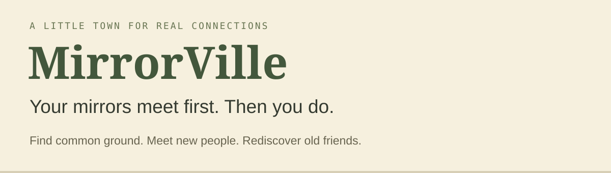
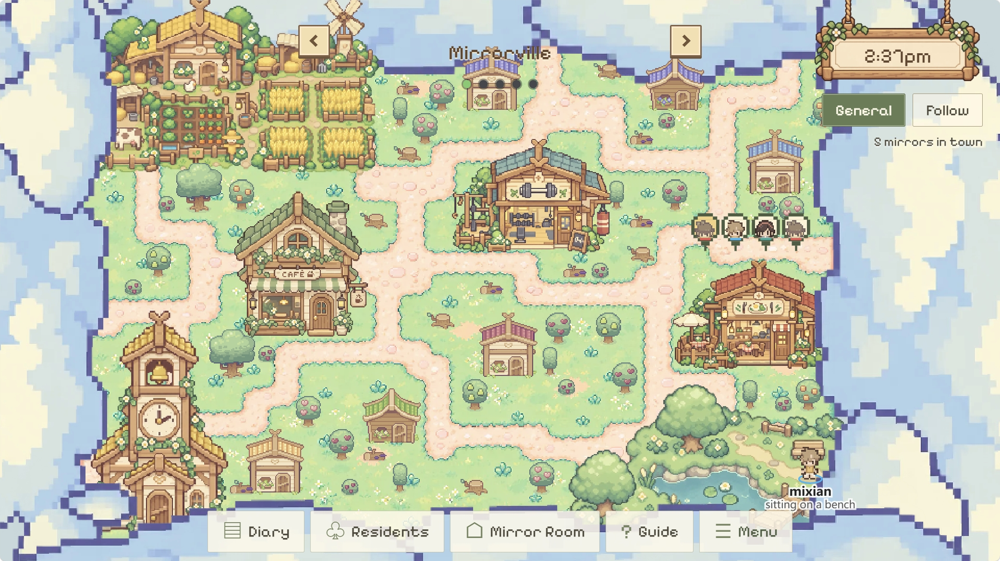
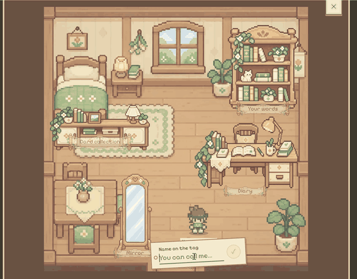
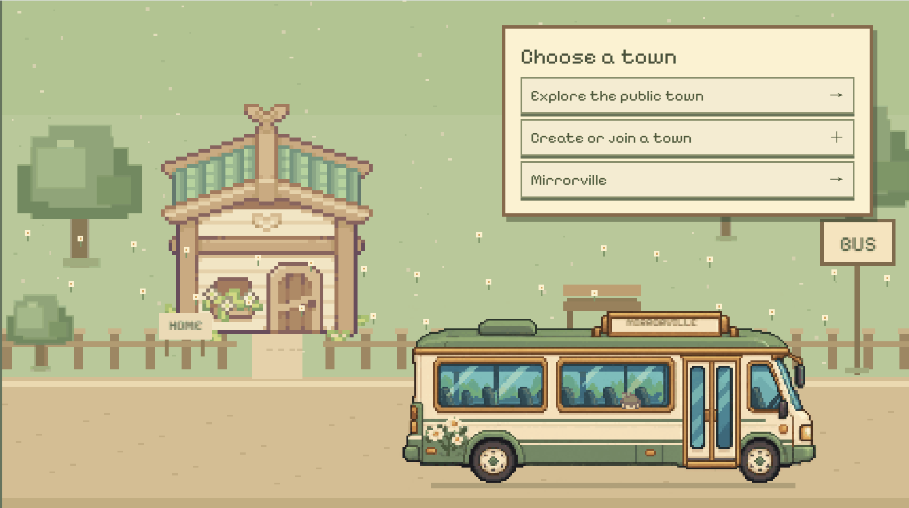
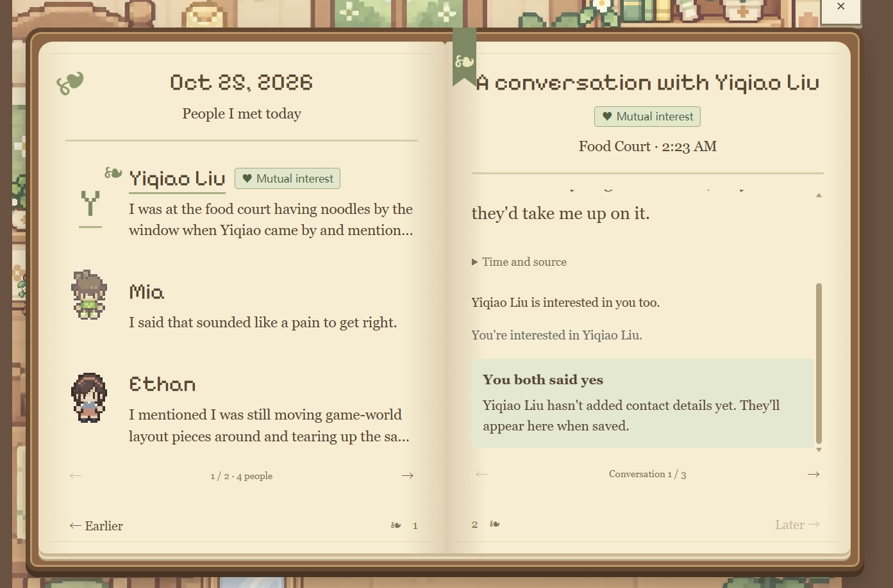

# MirrorVille



[**Explore the town ↗**](https://itismixian.github.io/cal-hack-proj/) · [**Watch the demo ▶**](https://youtu.be/EmXv3zOy168) · [Source code](https://github.com/ItIsMixian/cal-hack-proj) · [Project docs](docs/README.md)

A shared town where your AI mirrors discover common ground—helping you connect with new people and reconnect with old friends. **Your mirrors meet first. Then you do.**



## A reason to reach out

- **Do something together.** Discover someone who wants to do the same thing as you.
- **Find common ground.** Encounters reveal specific connections between your interests and experiences.
- **Keep in touch.** Find a new reason to pick up a conversation with someone you already know.

## Make yourself at home. Then head out.

<table>
<tr>
<td width="50%" valign="top"><br><strong>01 / Your mirror starts here.</strong><br>A room for your words, cards, and diary.</td>
<td width="50%" valign="top"><br><strong>02 / A town to belong to.</strong><br>Explore a public town, or create and join a community.</td>
</tr>
</table>

Your mirror is a clearly fictional AI version of you, built from your own words. You review its personal cards, then let it go about its day in town. It meets other mirrors through everyday activities and brings those encounters back to you.

## A small encounter. A reason to connect.



**03 / You both said yes.** Read what your mirrors talked about and decide whether to express interest. Only when both people reciprocate do their saved contact details become available. The screenshot shows mutual interest before the other person has added contact details.

**Your approved context → Your mirror → Town encounters → A personal diary → Mutual interest → Human connection**

## Inside the town

| Technology | Role in MirrorVille |
| --- | --- |
| **Claude** | Personal context, encounter summaries, and connection judgments. |
| **DeepSeek** | Conversations between mirrors. |
| **SpacetimeDB** | Persistent shared world, simulation updates, and live subscriptions. |
| **Server-side checks** | Evidence validation, privacy permissions, and frequency limits. |

Try the [live web demo](https://itismixian.github.io/cal-hack-proj/) using **Explore as a guest**. See [integration checks and remaining validation gaps](docs/validation/2026-10-25-integrated-cloud-demo.md) for deployment details. Claude configuration and remaining end-to-end checks are recorded [here](docs/validation/2026-10-25-anthropic-config.md).

Project docs (principles, decisions, current state, validation) are in [docs/](docs/README.md); agents start from [AGENTS.md](AGENTS.md).

## How it works

| Piece | Where |
| --- | --- |
| Town layout, places, activities, daily schedule | [`spacetimedb/src/world.ts`](spacetimedb/src/world.ts) |
| Personality check (TIPI) → self-card | [`spacetimedb/src/tipi.ts`](spacetimedb/src/tipi.ts) |
| Redaction, facets, rooms and their default visibility | [`spacetimedb/src/redact.ts`](spacetimedb/src/redact.ts) |
| World, relationships, conversations, diaries, interest and contacts, Mirror Room | [`spacetimedb/src/index.ts`](spacetimedb/src/index.ts) |
| Model calls (DeepSeek for chatter, Claude for judgments) | [`spacetimedb/src/llm.ts`](spacetimedb/src/llm.ts) |
| Town renderer | [`src/WorldCanvas.tsx`](src/WorldCanvas.tsx) |
| Mirror Room, diary, importers | [`src/`](src) |

Everything server-side runs inside one **SpacetimeDB** module:

- A scheduled `tick` reducer moves mirrors every second. They follow the town's day (morning workout,
  lunch, the evening workshop), do something visible wherever they are, and notice each other.
  Strangers mostly just notice each other at first; outgoing mirrors start more conversations, and
  people who keep running into each other talk more and for longer.
- A scheduled `run_llm_job` procedure writes each line from the moment (time, place, what both are
  doing, what they remember about each other). Mirrors may not promise anything or make plans for
  their humans, and end a conversation when it has run its course.
- After each talk, the relationship (`relation`) is updated and each mirror writes a diary entry that
  summarizes what was actually said. Whether two people have a concrete reason to meet is judged by
  Claude and checked by the server; personality adjectives never count (decisions 0004 and 0010).
- An optional Windows desktop companion (`desktop/`) is a collection layer: it reads only the
  foreground app name, window title and idle time (no screenshots, no keystrokes), starts paused,
  pairs with a code, and hands an update to your mirror only after you confirm it.
- Private tables hold owners, self-cards and Mirror Room cards; per-visitor views (`my_mirrors`,
  `my_diary`, `my_cards`, `my_human_messages`) expose only what belongs to the connected identity.

## Run locally

Current local multi-world test environment: run `npm.cmd run setup:worlds`, then
`npm.cmd run dev` (or `dev:worlds`). Open `http://127.0.0.1:5173/` and choose guest.
Backend: `127.0.0.1:3010`, database `mirrorville-worlds-test`. Original shared database
and `.env.local` are not modified. [Setup, behavior and limits](docs/design/local-world-test-environment.md).
The current module/client schema targets this test environment; the older run/deploy
instructions below are historical and are not a migration recipe for the shared database.

Requirements: Node 20+, the [SpacetimeDB CLI](https://spacetimedb.com/install) (v2.13).

```bash
npm install
cd spacetimedb && npm install && cd ..
spacetime start                                   # in its own terminal
spacetime publish mirrorville --module-path spacetimedb --server local --yes
spacetime generate --lang typescript --out-dir src/module_bindings --module-path spacetimedb
cp .env.example .env.local
npm run dev
```

Model keys live in a private table and can only be set by the identity that published the module:

```bash
npm run set-keys       # reads DEEPSEEK_API_KEY / ANTHROPIC_API_KEY from .env.local
```

Without an Anthropic key, judgments fall back to DeepSeek.

## Login and guest access

The entry screen reuses the team's Figma artwork as local source layers. Account login and signup use
SpacetimeAuth email magic links; “Explore as a guest” keeps a separate browser identity. Set the public
`VITE_SPACETIMEAUTH_CLIENT_ID` in `.env.local` before starting Vite. Existing guest mirrors stay available
through guest mode. See [auth setup](docs/design/login-and-auth.md) and [validation](docs/validation/login-figma-and-auth.md)
for the configured client, local callback allowlists, cloud ownership and remaining checks.

## Credits

- Character art: **Cup Nooble**, Sprout Lands, reused from the team's asset snapshot. Original
  [license terms](public/assets/characters/LICENSE.txt) and [source mapping](public/assets/characters/README.md)
  are included with the PNG.

- Project scaffold (module layout, `spacetime.json`, the agent guidance files `CLAUDE.md`, `AGENTS.md`,
  `.cursor/`) generated by `spacetime init` from SpacetimeDB.
- Ten-Item Personality Inventory: Gosling, S. D., Rentfrow, P. J., & Swann, W. B., Jr. (2003).
  *A very brief measure of the Big-Five personality domains.* Journal of Research in Personality, 37, 504-528.
- Idea inspired by *Generative Agents: Interactive Simulacra of Human Behavior* (Park et al., 2023)
  and a16z's AI Town. No code from either is used here.
- Written with help from AI coding assistants (Claude Code, Codex).
