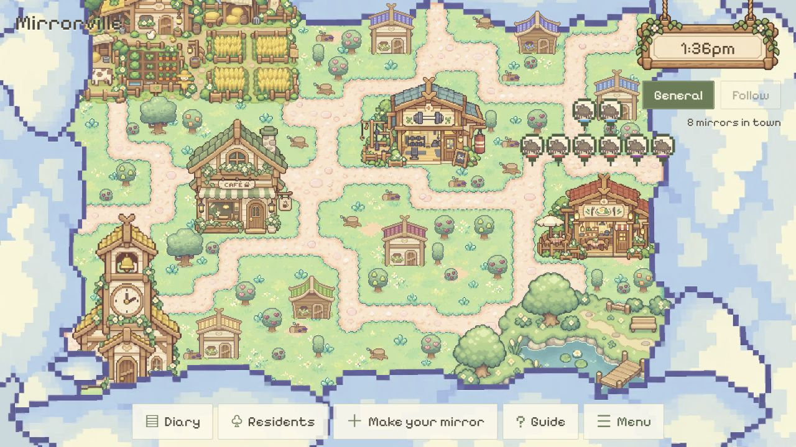

# Larger building resident pins — 2026-10-24

Local `yq` working changes in [WorldCanvas](../../src/WorldCanvas.tsx), following the user's request to enlarge the frames around indoor resident portraits.

- Enlarged the complete pixel portrait marker by 1.5×: outer width 26 → 39 CSS pixels, height 35 → 52.5. Portrait art and frame scale together; size stays constant on screen during camera zoom.
- Enlarged the click bounds to match. Column and row spacing increased from 28/38 to 42/57 pixels; conversation indicators move with the larger marker.
- `npm.cmd run build`: TypeScript and Vite passed.
- Actual local browser check at 1280 × 720 with eight indoor residents: six portraits in one row and two in the next rendered with separate frames. Clicking the enlarged left edge at (839, 235) opened the Tester character panel; closing it returned to the map. No shared resident or database writes were performed.
- Follow mode, physical phones and other browsers were not exercised for this visual adjustment.

