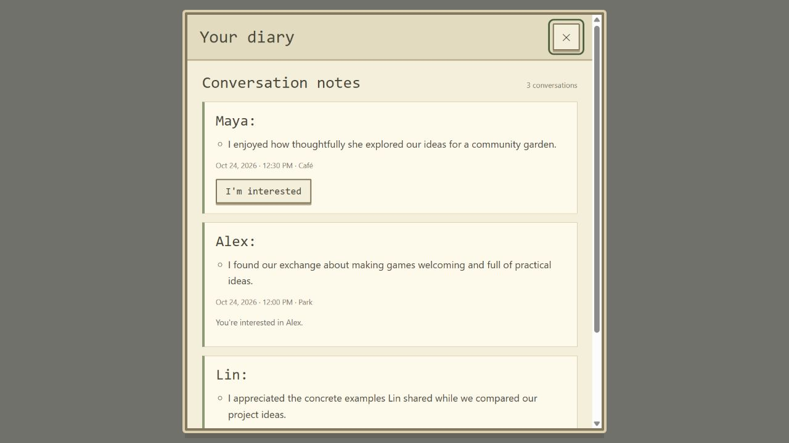
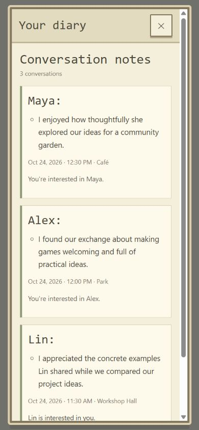
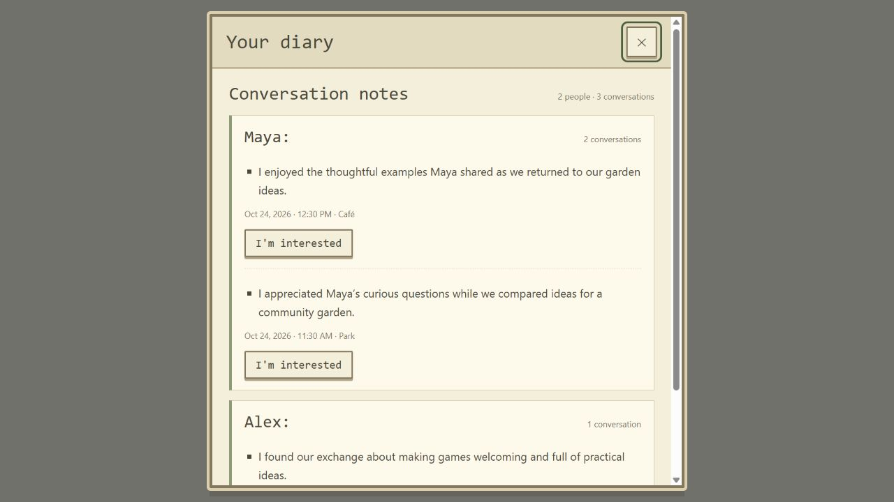
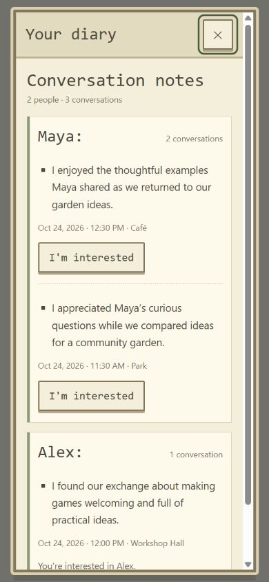
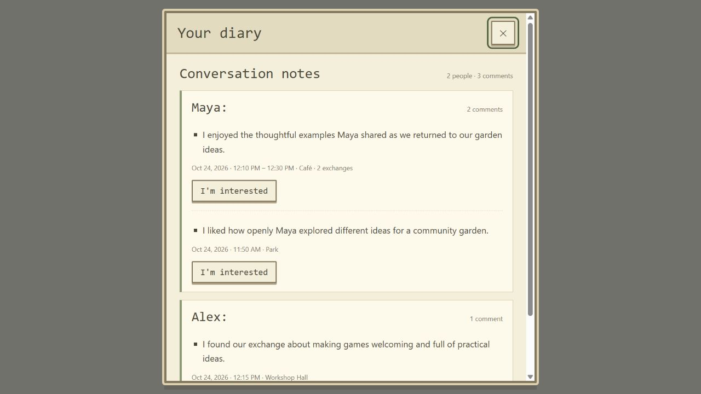
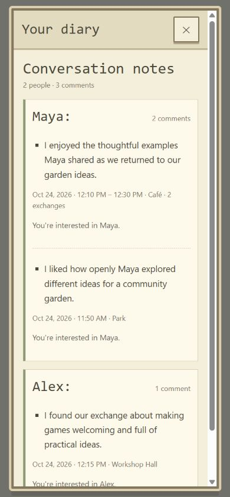
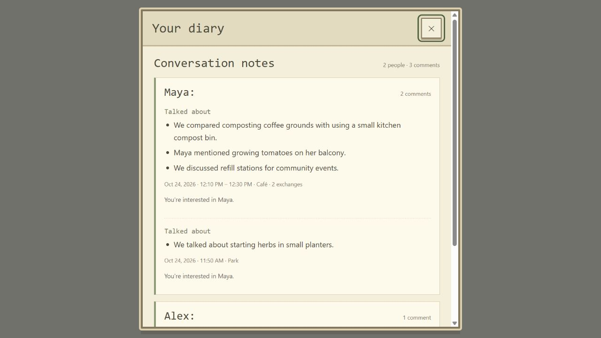
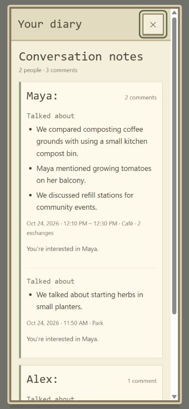

# Diary as conversation comments — 2026-10-24

Local `yq` working changes following the user's requested format: the other person's name,
one sentence evaluating the exchange, then its time and place.

## Implementation

- [Diary](../../src/Diary.tsx) now renders a newest-first comment list rather than one book
  page at a time. Each conversation retains its own entry, including repeat meetings. The
  room entrance filters by the current mirror; the town entrance includes the owner's mirrors
  and attributes each note. Metadata uses the stored entry timestamp (Los Angeles date/time)
  and venue label.
- [DiaryReview](../../src/DiaryReview.ts) uses native sentence segmentation to extract the
  last sentence of existing diary text without inventing a new opinion. It drops the old
  model-failure diagnostic sentence, retaining the factual fallback. New one-sentence notes
  display directly; empty text has a neutral missing-note label. Sentence-segmentation types
  are enabled through the TypeScript `ES2022.Intl` library.
- [Diary styles](../../src/diary.css) provide name headings, a single bullet and subdued
  metadata in a scrollable list. Retired book/page styles were removed. Existing interest
  actions, good-fit explanation and mutually unlocked contacts are retained.
- The [backend wrap prompt](../../spacetimedb/src/index.ts) now requests exactly one short,
  first-person reflection grounded in the actual topic/exchange, without unsupported
  personality judgments. Model-failure fallback is one factual sentence. No schema change,
  binding regeneration or rewriting of historical diary rows is needed.

## Executed checks

- `npm.cmd run build`: TypeScript and Vite passed.
- `node.exe --test scripts/test-diary-comments.mjs scripts/test-diary.mjs`: 18/18 passed.
  The new UI suite covers legacy/Chinese/empty/fallback sentences, chronological ordering,
  repeat meetings, date/venue display, mirror filtering and contact visibility. Existing
  backend tests cover owner isolation, interest/mutual contacts and model failure. The
  `test:diary` package script now includes both suites.
- `node_modules/.bin/tsc.cmd -p spacetimedb/tsconfig.json --noEmit`: passed.
- Browser preview used a source copy of the actual Diary component, replacing only its
  SpacetimeDB React hook import with an in-memory fixture; actual sentence helper, styles
  and RoomDialog were used. Three synthetic conversations showed names, one bullet each,
  descending date/time and venue labels. The local mocked interest action updated the
  correct comment.
- 1280 × 720 and 390 × 844 were visually checked. Portrait dialog client/scroll widths both
  measured 329px; longer comments wrap and the list scrolls vertically. Temporary fixture
  files were removed and the viewport restored. No live database access/writes were used.

## Not deployed or covered

The shared backend has **not** been published with the new prompt, and no live model call
was made to validate its output. Until a backend update, existing generation continues;
the new frontend extracts one existing sentence for display. Physical phones and other
browsers were not checked. Original stored diary text and existing contact privacy rules
are preserved. No commit, push, database migration or deployment was performed.

## Grouping by person — 2026-10-24

Following the user's next request, the UI groups notes under the other person's name, showing
the heading once and preserving each exchange as a separate sentence/time/place record.
Groups sort by their newest entry; each group's entries sort newest first. Filtering by the
current mirror runs before grouping. Interest/contact controls retain their entry IDs and
mirror attribution. This supersedes the earlier globally chronological list layout above.

- `npm.cmd run build`: passed.
- `npm.cmd run test:diary`: 19/19 passed. Added a regression for interleaved repeat meetings:
  the newest Maya note and older Maya note stay together before Alex, with only one Maya
  heading. Existing mirror filtering/contact privacy checks passed.
- Desktop 1280 × 720 and portrait 390 × 844 browser previews used the actual Diary source
  with only the SpacetimeDB hooks replaced by local fixture hooks, plus the real RoomDialog
  and styles. Two Maya conversations at different times/venues appeared together, followed
  by Alex. The header reported 2 people / 3 conversations. Both previews were visually
  inspected; portrait dialog client/scroll widths both measured 329px.
- Temporary preview files removed and viewport restored. No new backend/schema changes,
  database writes or publication. The prior one-sentence prompt remains unpublished.

API boundary: the current `DiaryItem` exposes `otherName` but no other-person ID, so this
iteration groups by the exact displayed name. Distinct residents with identical names share
a group; identity-based grouping requires exposing their IDs through the diary view.

## Nearby exchanges in one comment — 2026-10-24

The user requested merging same-person exchanges when venue and time are close. The
unspecified time interval uses a local implementation default of **30 real minutes**, measured
from stored note timestamps; it is not a consensus ADR or accelerated town-clock interval.

- [DiarySessions](../../src/DiarySessions.ts) retains person grouping and separates own mirrors.
  Continuous same-venue records merge only while the entire earliest/latest span is at most
  30 minutes. This prevents an endless chain of small gaps merging hours of notes. A venue
  change for that mirror/person pair starts a separate visit, even when the pair returns soon.
- Each visit renders one existing latest reflection, the earliest/latest timestamp range,
  venue and exchange count. These are note timestamps, not measured conversation durations.
  A range crossing midnight includes both dates. Person/group order stays newest first.
- Interest/contact controls use the latest source entry's original reducer ID and pair state.
  A supported good-fit explanation from any source exchange in the visit remains available.
  No new opinion is synthesized and no stored diary rows are changed or deleted.
- `npm.cmd run build`: passed. `npm.cmd run test:diary`: **23/23 passed**. New cases cover the
  inclusive 30-minute boundary, wider gaps, bounded total span, intervening venues, separate
  people/own mirrors, one review/action with range/count, preserved fit evidence and midnight.
- The actual Diary component preview (only SpacetimeDB hooks replaced by in-memory fixtures)
  displayed four synthetic exchanges as three comments under two names: Maya's Café records
  at 12:10 and 12:30 merged; her 11:50 Park record stayed separate. The merged comment's
  interest action succeeded with a fixture reducer that required the latest original ID.
- Desktop 1280 × 720 and portrait 390 × 844 screenshots were visually inspected. Portrait
  dialog client/scroll widths both measured 329px. Temporary preview files were removed and
  the browser viewport restored. No database writes, schema changes or publication occurred.

The previously documented displayed-name identity limitation remains. The earlier backend
generation prompt is still unpublished. Physical phones and other browsers were not tested.

## Conversation content instead of appraisal — 2026-10-24

The user's latest preference is to record the exchange's actual content and things mentioned.
This supersedes the earlier single-appraisal display and latest-note-only visit summary.

- `DiaryReview.ts` now exports `diaryTopics` and `sessionTopics`. Native sentence segmentation
  retains original content/details, with lightweight English/Chinese rules omitting common
  setting/appraisal-only sentences and the old model-failure diagnostic. Content remains
  verbatim; it is not a newly synthesized summary. All source notes in a visit contribute,
  with normalized case/whitespace/terminal-punctuation duplicates removed.
- Diary displays a “Talked about” bullet list, retaining names, chronological person/visit
  grouping, 30-minute merging, time/place ranges, fit evidence and interest/contact controls.
  Notes with no usable content show a missing-topics message instead of a fabricated topic.
  The room's diary hint now describes who met and what was discussed.
- The backend wrap prompt now requests 2–4 concrete transcript topics, questions, examples,
  named things or ideas in 1–3 short sentences, without generic personality appraisals. It
  explicitly excludes profile/card facts that were not spoken and requires brief greetings
  to remain brief. JSON fields and schema are unchanged.
- Production build and backend TypeScript check passed. `npm.cmd run test:diary`: **25/25
  passed**, covering English/Chinese content selection, factual details without topic verbs,
  empty/appraisal-only/model-failure notes, normalized duplicate removal and contributions
  from older merged notes, alongside grouping, filtering and contact privacy regressions.
- Browser preview used actual Diary/helper/dialog/styles with only SpacetimeDB hooks mocked.
  Two Café notes became one comment containing three distinct factual bullets: coffee-ground
  composting, balcony tomatoes and event refill stations. The repeated composting sentence
  appeared once; a Park visit remained separate. Desktop 1280 × 720 and portrait 390 × 844
  were visually inspected; portrait client/scroll widths both measured 329px. Temporary
  fixtures were removed and the viewport restored.

Limits: the legacy filter is heuristic, so a content-bearing sentence may retain its original
subjective wording. It cannot reconstruct topics absent from the stored text. The new model
prompt is local source only, **not published or live-model verified**; shared generation is
unchanged until deployment. No historical rows, private data, schema or database were changed.
Physical phones and other browsers were not checked.

## Concise chat-only summary — 2026-10-24

User requirement: keep only chat content, summarize briefly, and omit unrelated AI actions
in the scene. This supersedes the unbounded topic-list display described above.

- `DiaryReview.ts` filters common English/Chinese simulation actions, gestures, stage
  directions, scene clauses and AI decisions, including action sentences containing words
  such as "project" or "question". Mixed clauses retain available speech content. Reported
  discussion about an action remains, e.g. walking routes or what someone said about coding.
- `sessionSummary` deduplicates source content and selects at most two sentences, with
  additional limits of 50 words and 280 characters per merged visit. An oversized first
  sentence is shortened with an ellipsis. This is an extractive summary of existing diary
  text, not a fresh model paraphrase or reconstruction of missing transcript content.
- Diary displays that summary as one paragraph. Existing person grouping, visit boundaries,
  timestamps, venue, original interest reducer IDs, fit evidence and mutual-contact privacy
  remain covered by the regression suite.
- The backend prompt now requests only spoken chat content in 1–2 sentences (40 words or
  100 Chinese characters), excluding scene narration, actions, AI thought processes and
  appraisals. Failure now stores `Conversation summary unavailable.` rather than an activity
  sentence; the client renders the existing missing-content message for that marker.
- **PASS:** `npm.cmd run test:diary`, 30/30, including bilingual narrative filtering, mixed
  clauses, legitimate action discussion, long/duplicate merged notes, compact actual Diary
  server rendering, failure fallback and existing ownership/contact regressions.
- **PASS:** `npm.cmd run build`, `npx.cmd tsc --noEmit -p spacetimedb/tsconfig.json`, and
  `git diff --check`.

Limits: old prose uses heuristic filtering and may still contain unrecognized narrative or
omit an ambiguous fact. Only the first two distinct eligible sentences are selected, in the
existing newest-note order. No live model, browser interaction or new screenshot was checked
for this revision; images above document earlier displays. The generation prompt and failure
fallback have **not been published** to the shared backend. No historical rows, schema or
shared database data were modified.

## Since the previous close — 2026-10-24

User requirement: Diary should display only content generated since the previous close.

- `DiaryHistory.ts` persists microsecond cutoffs under `mirrorville-diary-closed-v1/<identity>`.
  Town Diary updates the global cutoff; room Diary updates only that mirror's cutoff. The
  effective cutoff is the later of the global and mirror values. First use starts at zero.
  Updates never move the boundary backward; corrupt/blocked storage falls back gracefully,
  with an in-memory session copy after a close when persistence is unavailable.
- `useDiaryWindow.ts` freezes the read boundary per open window and saves browser wall-clock
  close time on real unmount or pagehide. Deferred cleanup distinguishes React StrictMode
  effect replay from closing. Identity/scope changes save the prior window under its owner.
- Diary filters `createdAt > cutoff` before person/visit grouping and summary extraction.
  Thus old notes cannot contribute to a new visit's text or timestamp range. With no new
  notes it shows “No new conversations”; the heading is “Since your last visit”.
- App's quiet new-content dot uses the same per-mirror cutoffs and refreshes on close/storage
  events. Removed the previous open-time seen tracking and room-open global seen update.
- **PASS:** `npm.cmd run test:diary`, **37/37**. Added fresh-module persistence, first visit,
  strict timestamp boundary, pre-merge filtering, independent mirrors/identities, corrupt and
  blocked storage, real close vs StrictMode replay, pagehide, frozen snapshots and account
  transition checks. Existing summary, ownership and mutual-contact regressions also pass.
- **PASS:** `node --test scripts/test-home-scene.mjs`, **3/3**; `npm.cmd run build`;
  `git diff --check`. Documentation reader rebuilt.

Limits: this revision was checked with component server rendering and a simulated hook/event
lifecycle, without live browser clicks or cross-device testing. Cutoffs use this browser's
clock and storage; they do not synchronize across devices/browser profiles. Clearing storage
restores history; blocked storage cannot persist across a full reload. Late-arriving records
whose creation timestamp is at or before close remain excluded. Pagehide delivery is subject
to browser lifecycle behavior. No database rows are deleted or modified; hidden historic
interest/contact controls are no longer reachable through this filtered Diary view. Backend
prompt changes from the earlier revision remain unpublished.
