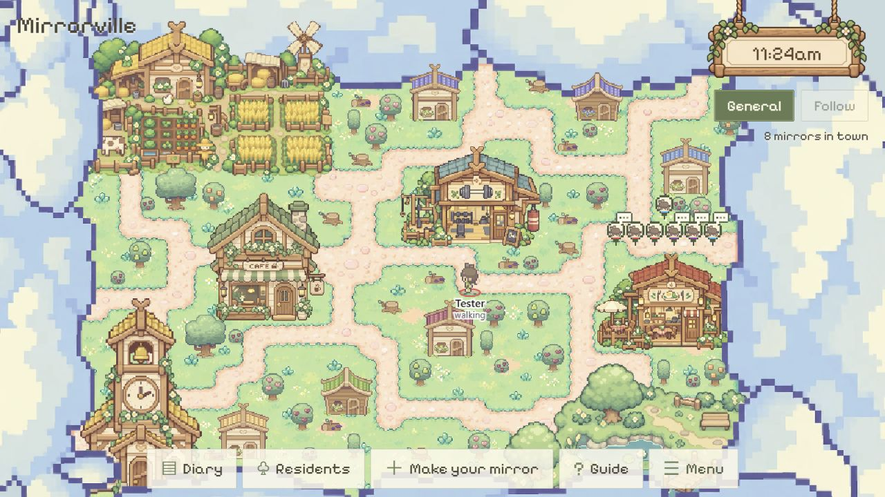
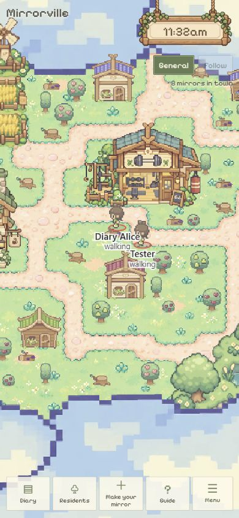

# General mouse-wheel zoom — 2026-10-24

Scope: local `yq` working changes over `a416066`, following the user's request for mouse-wheel zoom in General mode without blank borders at minimum zoom.

## Behavior

- General consumes ordinary wheel input on the map: up zooms in, down zooms out. Zoom follows the town point under the cursor until a map boundary limits movement. Pointer dragging remains available.
- Minimum zoom is `max(viewportWidth / 960, viewportHeight / 672)`, so the authored town covers the viewport. Maximum zoom is four times that minimum. Camera position is bounded on every rendered frame, including easing and viewport changes.
- Follow keeps its existing target behavior. Ctrl-wheel is left to browser zoom.

Implementation: [camera geometry](../../src/TownCamera.ts), [Canvas interactions](../../src/WorldCanvas.tsx), [camera/scene tests](../../scripts/test-town-scene.mjs).

## Executed checks

- `npm.cmd run build`: passed TypeScript and Vite production build.
- `node.exe --test scripts/test-town-scene.mjs`: 14/14 passed. Coverage includes desktop/portrait/ultrawide viewports, extreme zoom/pan bounds, cursor anchoring, zoom-out after edge panning, resizing, inverse picking and existing Follow geometry.
- `git diff --check` for the changed code and tests: passed.
- Actual browser wheel and drag input on local `http://127.0.0.1:5173/`, in an isolated guest tab, with the authored map loaded:
  - 1280 × 720: wheel-up increased zoom from 1.333333 to 5.333333; dragging changed the camera center. Wheel-down returned to 1.333333. Dragging toward an edge at minimum left the viewport inside town bounds (x 0–960, y 0–540).
  - 390 × 844: viewport resizing selected minimum zoom 1.255952. Wheel-up reached 5.023810; wheel-down returned to the minimum. The visible town bounds stayed inside x 324.739–635.261, y 0–672.
- Restored the browser viewport after checking. Screenshots were visually inspected; map artwork fills both viewports.

## Limits

The guest session had no owned mirror, so switching into active Follow was not exercised in the browser; existing Follow geometry tests passed. No physical-phone or cross-browser check was performed. No shared resident writes, database publication, commit or push was performed for this change.
