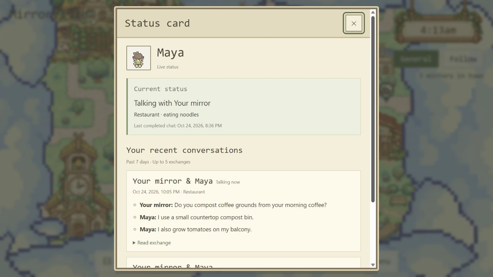
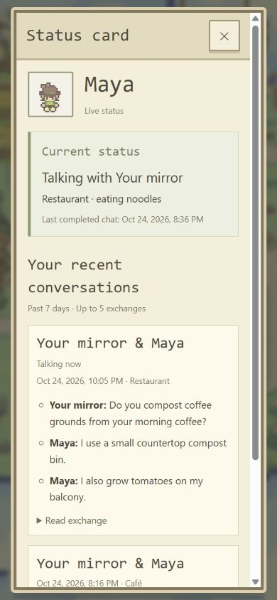

# Building resident Status cards — 2026-10-24

Local `yq` working changes implement the user's request to open a Status card from each
building resident tag. The user explicitly selected **my character's exchanges with them**
as the history scope. The 7-day window and maximum of 5 exchanges are implementation defaults.

## Implementation

- [App](../../src/App.tsx) retains the existing Canvas/tag and Residents selection routes,
  replacing the selected resident's single raw conversation panel with a Status card.
- [ResidentStatusCard](../../src/ResidentStatusCard.tsx) shows the selected name/avatar,
  current activity, conversation partner when available, authored venue and last completed
  chat timestamp. Reconnecting data is labelled last known status. Own cards retain the
  existing Mirror Room entry; public intent remains visible when present.
- [ResidentConversations](../../src/ResidentConversations.ts) matches exact participant IDs
  against the owner's mirror IDs, takes exchanges active within the past 7 real days and
  orders the newest 5 by latest message/start time. Empty ownership/history never falls
  back to the resident's unrelated public conversations.
- Each exchange shows time/place and up to 3 source sentences, including both speakers
  and a recent point when available. Greetings, repeated text and `[END]` are removed.
  These are extractive content highlights, not model-generated summaries. The original
  exchange can be expanded. Missing messages and greetings-only exchanges have explicit
  labels. Private profiles/contact fields are not used by this component.

## Executed checks

- `npm.cmd run test:status-card`: **7/7 passed**. Covers participant/owner ID scope,
  guest/empty states, 7-day boundary, recent messages in older exchanges, ordering/cap,
  source immutability, greetings/deduplication, both speakers, invalid speaker exclusion,
  status/venue rendering, unrelated/private-field exclusion, escaping and own-room entry.
- `npm.cmd run build`: TypeScript and Vite passed after removing all preview fixtures.
- Browser preview used a copy of the actual App with only the SpacetimeDB React hooks
  replaced by in-memory fixtures. Actual WorldCanvas, authored map, selection callbacks,
  RoomDialog, Status card and history helper were used. Three synthetic residents and
  two owner/selected-resident exchanges plus one unrelated exchange were seeded.
- Actual clicks on three Restaurant portrait tags opened Maya, Alex and Your mirror
  respectively. Maya displayed the two relevant exchanges, content highlights and current
  partner. The unrelated exchange marker was absent. Alex displayed an empty owner-history
  state; the own card retained Open Mirror Room. Switching back selected Maya correctly.
- Read exchange expanded the matching transcript. Desktop 1280 × 720 and portrait
  390 × 844 layouts were inspected. Portrait dialog client/scroll widths both measured
  329px; content scrolls vertically without horizontal overflow. Temporary fixture files
  were removed and the viewport override was reset.

## Limits

The browser owner/history check used synthetic local data, not an authenticated real user's
shared database history. No account creation, database writes/publication, model calls,
physical-phone or cross-browser checks were performed. Status uses existing activity and
last-chat fields; no historical status timeline or invented activity-change timestamp is added.
