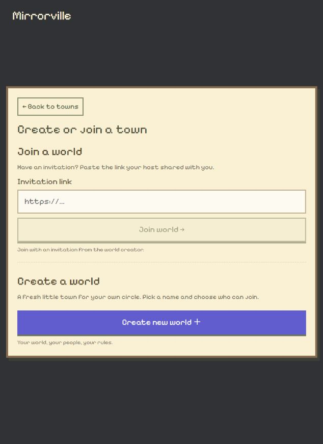
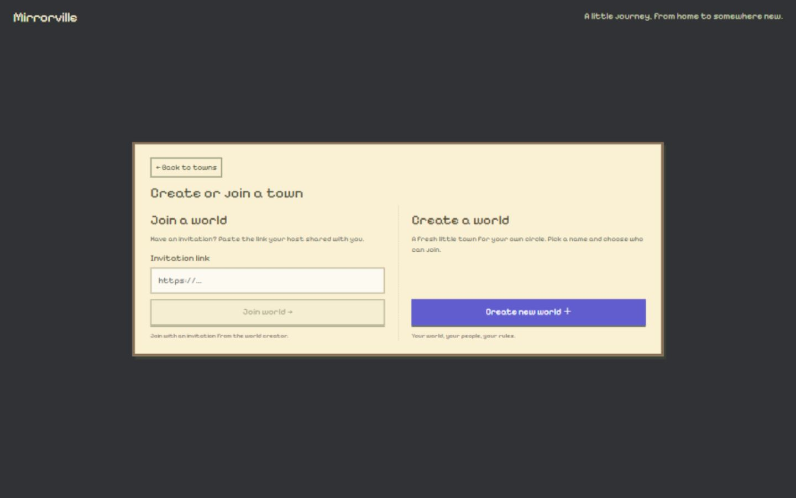
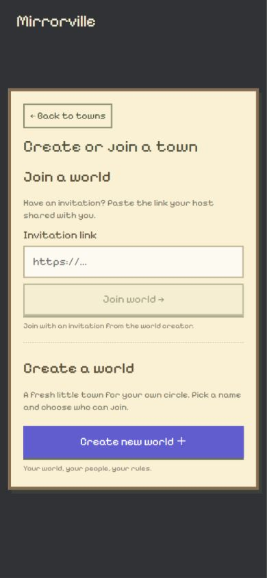

# 创建／加入窗口居中加宽

2026-10-25。用户要求创建／加入窗口居中、变宽，并尽量在没有滚动条时完整显示内容。应用文字继续为英文。

## 改动

仅调整 `src/world-journey.css` 的空世界／创建加入状态。该状态不再受车旁 440px 小选择框的宽高约束；窗口在视口水平、垂直居中，最大宽度 960px，使用可用屏幕宽度。品牌标题独立置于页顶，不影响窗口中心。

680px 以上 Join/Create 两栏并排，较窄屏幕单列；压缩空白和规则行间距，保持至少 44px 按钮。该表单状态隐藏无关的 Replay/Skip 工具栏，返回按钮仍在窗口内。保留 max-height 和 overflow:auto 作为小屏、键盘／缩放、长错误文字等情况下的兜底，不通过裁切内容来假装无滚动条。

## 实际检查

- `npm.cmd run build` 成功（TypeScript + Vite worldtest）。CSS 展示改动没有新增或重跑行为单元测试。
- 原窗口 635×871：框宽约 611px，水平／垂直居中；clientHeight=scrollHeight=524，无内部滚动条，邀请和创建区全部可见。
- 桌面 1440×900：框宽 960px、两栏各 448px；中心偏差 0；clientHeight=scrollHeight=379，无内部滚动条。
- 手机 390×844：框宽 366px，中心偏差不足 0.01px，clientHeight=scrollHeight=577；纵向完整显示邀请与创建入口。
- 手机打开 Create world 表单后，压缩规则行间距，clientHeight=scrollHeight=702，仍无内部溢出。取消正常，未提交创建或修改用户数据。
- 浏览器检查结束恢复正常视口，并停留在创建／加入入口。
- `git diff --check` 通过，文档阅读页重建。未改后端、邀请、容量、独立分身或选择逻辑；未公开发布或推送。

