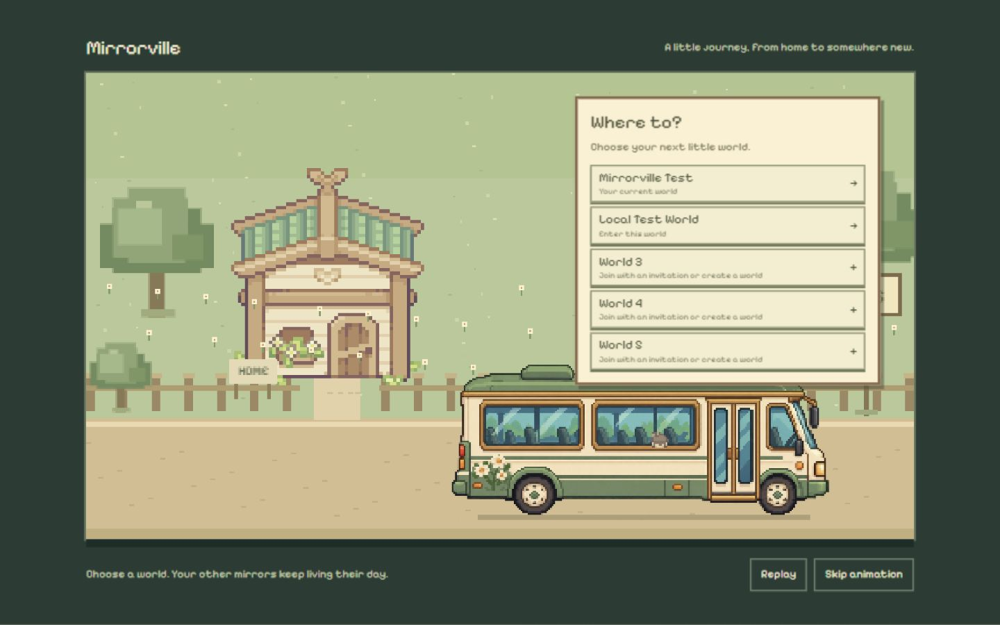
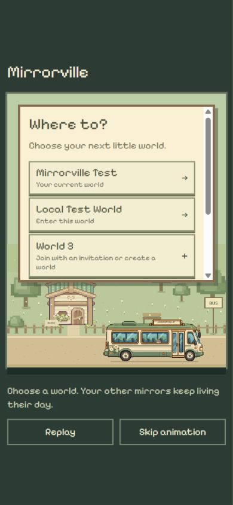
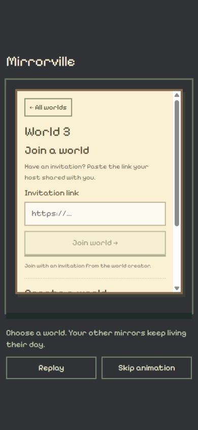

# 离家上车接入真实世界选择

2026-10-25。用户明确要求直接接入 yw/map-assets 的离家上车流程，其他分支改动暂时忽略。

## 来源与交付

只从 `1ec3221908dfeb360bc34d8278c85c07baaf0352` 的第一父提交差异引入 `prototypes/departure/` 与 `docs/validation/departure-animation-preview.md` 共 10 个文件，逐个字节比对一致。原独立预览保持原样。将原型 assets 的图片、字体和许可原样复制到 `public/assets/departure/`，附来源说明。

没有合并整个分支，没有导入其角色系统、换外观、登录持久化、社交节奏、Maincloud 发布、文件删除或布局回退。本轮未修改／发布后端、生成绑定或更改旧数据库与身份。

## 正式流程

- 登录进入 App（包括刷新重新挂载）先展示离家、候车、车辆停稳开门、绕行上车和窗内头像，约 6.4 秒后显示真实世界列表。地图左右按钮及 Menu → Travel to a world 可再次打开旅程。
- `DepartureScene.ts` 复用原型的路径、站台绘制及裁剪头部，`WorldJourney.tsx` 负责 React 生命周期、按钮、选择容器、资源失败回退和移动端布局。
- App 中的目的地取自现有五个世界位置；进入已有世界调用原 `enterWorld`，空位用原 EmptyWorld 与 WorldSettings 提供邀请／创建。不存在世界的入口仍为深灰色纯色背景。
- reducer 成功且成员视图确认当前世界后才播放离站，约 2.1 秒后显示该小镇。失败保留输入及错误，不离站。重复邀请按 SDK 已提交缓存找到实际成员位置，不强等所请求的空位，避免复用已有成员时卡住。
- Replay / Skip animation 只控制画面；不会加入世界或创建分身。Arrive now 仅在后端已经确认后出现。减弱动画直接选择，仍走后端确认。图片失败允许继续选择，卸载清理 RAF，StrictMode 旧加载回调不更新卸载组件。
- 动画是视觉过渡；原世界分身不迁移、不停止。继续使用原有独立模拟与自动原型生成逻辑。

## 实际检查

- `npm.cmd run build`：TypeScript + Vite worldtest 生产构建通过。
- 相关单元测试共 93 项通过：原 88 项 + `scripts/test-world-journey.mjs` 5 项。新增覆盖候车时人物避开行进车辆、窗内只绘裁剪头部、无确认不离站、Skip/Replay 不隐式进入、减弱动画、加载前选择不会被加载完成重置、资源失败与卸载清理。
- 真实浏览器 `http://localhost:5173/` 刷新显示旅程。选择 Mirrorville Test 后实际看到 Travelling/Next stop，再进入对应地图；地图箭头能再次打开旅程，Skip 后仍停在世界列表，不自动选择。
- 从 World 3 空位输入 64 位零的无效邀请，后端返回 Invitation is invalid or has been replaced；仍停在选择状态，没有离站。创建表单打开与取消正常，没有创建测试世界。
- 从房主页面复制现有 Local Test World 邀请，在已有成员 localhost 身份的 World 3 空位输入。实际成功播放 Next stop: Local Test World，并返回原第 2 位置；World 3 保持未创建。未在日志、文档或截图保存真实 token。
- 1440×900 桌面和 390×844 竖屏实际检查与截图：居中布局、车辆／窗内头像可见，五位置列表和较长表单在面板内滚动，底部控件可见，空位背景为深灰色。检查结束恢复正常视口。
- 交付的 10 个原文件及运行素材完成字节一致性检查；`git diff --check` 通过。根目录与子仓库文档阅读页重建。

## 未覆盖项与边界

本轮浏览器未提交新建世界或加入全新世界，避免占用现有游客位置；这些成功分支复用已有 reducer 和统一确认逻辑，后端的既有真实多身份验证见自动分身交付记录。真实 AI 密钥仍未配置，未验证模型内容生成。既有 Status card 测试套件的历史失败不计入本轮相关套件，不能表述为所有测试通过。

场景乘客保留原型的 Cup Nooble 精灵，未引入另一分支的五角色外观系统；个人外观映射可单独讨论。仍是本机环境，未公开发布、提交或推送。
