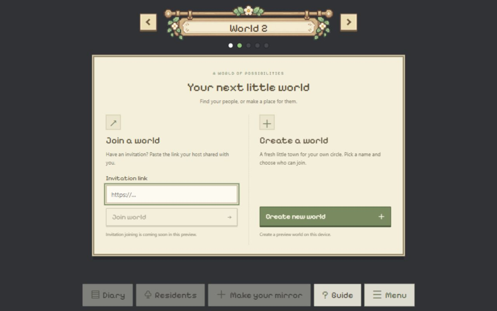
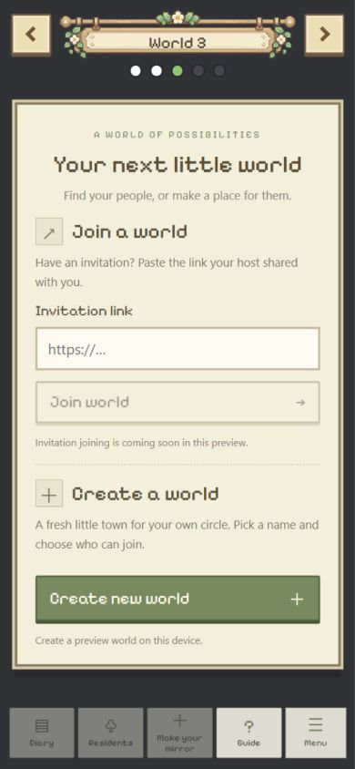

# Empty-world join/create window — 2026-10-25

Base: `yq` at `d85c3ed`, including the uncommitted world navigator/settings previews.
User asks for a window with invitation-link entry and new-world creation in an uncreated
world. The earlier user choice to keep world features as frontend previews remains in scope.

## Implementation

- `EmptyWorld.tsx` renders the two sections on the existing dark-gray background.
  `empty-world.css` uses two columns on desktop and stacked sections on mobile.
- The input checks full HTTP(S) URLs. Blank input disables Join world; invalid input
  has an inline error. Valid syntax gets an explicit notice that real invitation joining
  is not available. No URL is fetched or visited and no membership is recorded.
- Create new world opens `WorldSettings` in creation mode. Saving updates this slot's
  local settings, title and existing/current dots; it shows the authored map with zero
  residents. Cancel leaves the slot uncreated. Valid saved slots restore after reload.
- Live backend resident presentation and Diary/Residents/mirror creation actions stay
  scoped to slot 1. Preview slots do not reuse live residents or private diary records.
  Mirror Room remains the same personal-room entry when an owned mirror is available.

## Actual checks

- PASS: TypeScript/Vite production build and `git diff --check`.
- PASS: real local browser, empty World 2, Join disabled while blank. A `javascript:`
  URL produced the inline complete-HTTP(S)-link error. An HTTPS example URL produced
  the coming-soon notice, leaving World 2 uncreated. No navigation or actual joining.
- PASS: created My world in slot 2, default strangers off / 20 people. Title changed;
  two dots were now existing. Preview map had one canvas and zero residents, with
  Diary disabled. Changed its capacity to 8 through Edit world and saved.
- PASS: after a full reload and selecting slot 2 again, My world and capacity 8 were
  restored. Slot 1 remained Mirrorville. This local sample remains on the test browser.
- PASS: opened Create new world in slot 3 and canceled; World 3 stayed uncreated.
- PASS: 1280 × 800 desktop and 390 × 844 portrait layouts inspected. Mobile document
  width was 390px; both section actions fit in the panel, with panel client and scroll
  heights both 614px. The navigator and dock remained outside the panel. Viewport
  override reset; the preview was left at the uncreated slot's window.
- The owned-mirror room round trip was not live exercised here:
  this browser guest has no owned mirror. Source retains the same enabled personal entry.

## Limits

Creating a world here stores frontend preview data on this browser origin only. It does
not create a database world, server membership, independent simulation or secure room.
Invitations are not validated for authenticity/expiry/capacity and cannot yet be accepted.
There is no real-user join, model call, server publication or shared-data change in this
revision. Physical phones, other browsers and denied-storage creation were not exercised.

## Screenshots

