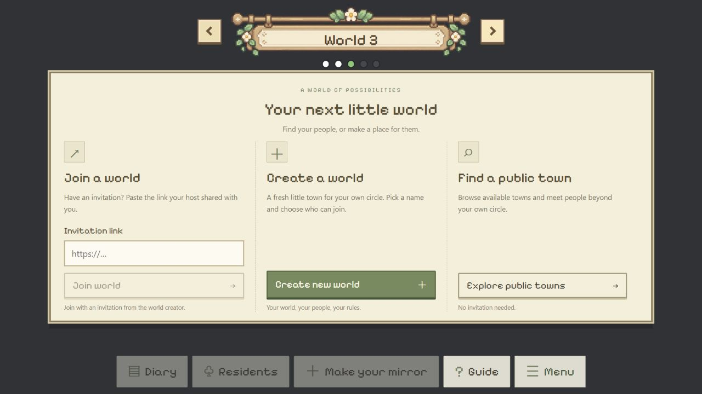
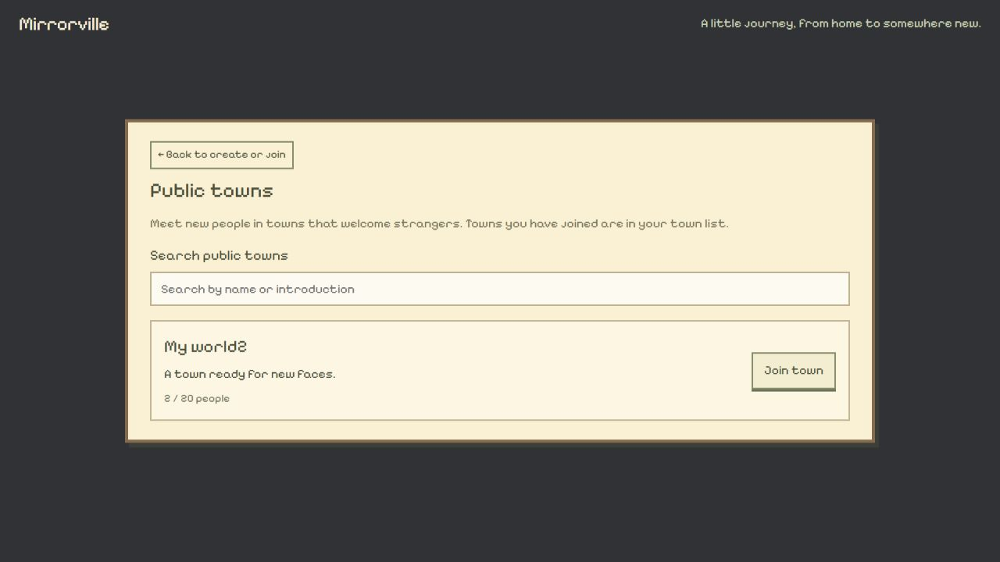

# 创建／加入页面中的公共小镇检索

2026-10-25。用户用空小镇创建／加入窗口截图，要求在这个界面也增加检索所有可以加入的公共小镇。

## 实现

- `EmptyWorld.tsx` 增加第三个入口 Find a public town／Explore public towns。大屏三栏，中等宽度公共入口换行，手机单栏；保留邀请和创建表单。
- 地图空位置和房间出发后的创建／加入页都复用 `PublicTowns.tsx`，仍读取 sender-scoped discoverable_worlds，不公开邀请或分身资料。没有重新实现准入。
- Search public towns 按名称及简介即时筛选，去除查询首尾空白并忽略大小写；空查询显示所有当前可加入项，无匹配时显示提示。成员容量、已加入及陌生人许可筛选保持原实现。
- App 保存进入发现前的邀请草稿；Back to create or join 返回来源表单。地图来源回到原空位置，旅程来源回到原创建／加入页；不提交邀请草稿，也不访问其中 URL。
- 地图来源打开静态选择容器，没有车动画。实际加入继续走 joinOpenWorld 和服务器确认；从房间出发的旅程维持原动画规则。没有后端变更或发布。

## 实际检查

- `npm.cmd run build`：TypeScript + Vite worldtest 生产构建通过。
- 浏览器 `http://127.0.0.1:5173/`：房间出发 → 创建／加入，实际看到公共入口；点击后看到 Public towns、搜索框、真实可加入小镇 My world2、简介占位及 2 / 20 people。
- 输入 no-such-town-qa 显示无匹配；改成 MY WORLD2 后显示 My world2，验证大小写无关名称检索。不点击 Join town。
- 邀请框填写非真实示例地址 https://example.com/town，仅用于本地输入保留检查：公共列表返回后保持原值，没有提交／请求此地址。
- 进入已有地图后，用左右控制器到 World 3 空位，实际看到三栏入口。公共入口立即进入 Town selection，没有车场景／动画按钮；Back 返回 World 3，并保留示例邀请输入。
- 1280×720 窗口实际截图与 DOM 测量：创建／加入窗口宽 1100px，clientHeight=scrollHeight=452px；三个入口与按钮都可见，无内部滚动。公共列表实际截图如下。
- `git diff --check` 通过；根目录与子仓库离线文档阅读页重建。

## 未覆盖

没有为验证提交加入／创建或更改已有小镇；准入和独立分身仍以此前后端多身份验证为依据。本轮只实际验证名称筛选，非空简介匹配及移动／中等视口布局由实现处理，未做实际浏览器检查。未重新测试人数／权限竞争、网络中断、真实登录或模型调用。
