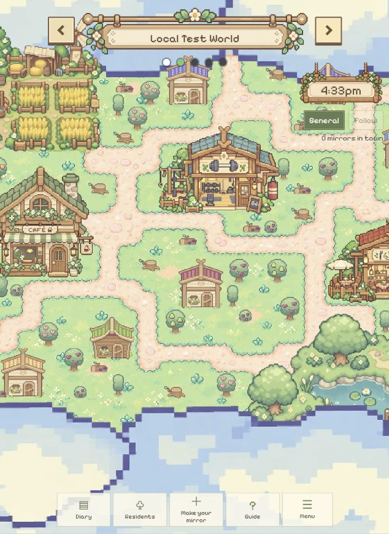

# 独立世界分身与持续模拟验证

日期：2026-10-25。用户明确要求各世界分身独立、互不影响且内部持续运行，取代初版切换世界会迁移全部分身的行为。环境为本机 SpacetimeDB 2.13.0，`mirrorville-worlds-test`（3010）及 worldtest 前端（5173）；未发布共享库。

## 改动与升级证据

- `spacetimedb/src/index.ts` 的 `activateWorld` 只更新查看选择，保留原居民位置、归属、休息及正在进行的对话。
- 新分身在当前世界创建；`myMirrors`、卡片、摘要、导入与日记视图按世界过滤，修改分身和卡片校验当前世界，档案和联系方式分别绑定各自分身 ID。
- 每人每世界 3 个分身、每世界 60 个居民、6 场并发对话，每人每天每世界 2 个 good-fit 标记；导入处理中互斥也按世界计算。
- 新私有表 `world_simulation` 使用 world ID 维护移动与社交时钟。每次后台 tick 遍历全部世界；不同世界使用各自确定性随机流，其他世界增加居民不会消费本世界随机序列。旧 `world_runtime` 保留但不再作为模拟时钟。
- 执行 `scripts/start-local-worlds.ps1`，实际迁移计划仅新增私有 `world_simulation` 表，发布成功；`--delete-data=never`，未清空已有世界、成员、档案或角色。重新生成客户端绑定。
- `App.tsx` 世界变化时关闭旧房间／编辑／创建弹层，避免继续操作上一世界的分身；画布原本已按世界 key 独立挂载。

## 实际验证

- `npm.cmd run build`：TypeScript 和 Vite worldtest 构建成功。
- `npx.cmd tsc --noEmit -p spacetimedb/tsconfig.json`：成功。
- 相关单元检查共 85 项通过：Diary 46、roaming 7、fidelity 12、importers 10、auth 10。首次合并执行 83 项，补充世界容量／导入互斥两项后独立重跑全部 22 项 backend diary 回调检查通过；其余未变。
- 新增 7 项独立世界回归覆盖：切换保留原居民／对话／休息、同一主人不同分身与私有资料／额度、无查看者时持续移动与随机流独立、他世界繁忙不耗本世界对话额度、他世界每日标记不耗本世界额度、他世界人数满不阻塞本世界创建、他世界导入中不阻塞本世界导入。
- `npm.cmd run test:worlds:live`：真实 SDK 6 组检查通过。四个合成身份验证房主权限／私有邀请／错误 token／容量事务、公开视图和 7 张私表 SQL 拒绝、开放加入／替换邀请、跨世界独立分身与联系方式往返、原世界分身在主人查看另一个世界时继续移动、重连保留当前世界，以及并发加入最后名额只有一个成功。
- 核心 live 断言：A 在私人世界创建分身 X、设置联系字段；A 回大厅时 B 仍看到同一个 X，A 当前私人分身视图为空。在大厅创建 Y 后确认 X 与 Y ID 不同；修改 Y 的联系方式和意向再往返，X 的字段不变，Y 保留自己的字段。随后直接通过 B 的实时订阅观察到 X 的坐标继续变化。
- 浏览器 `http://localhost:5173/` 用已有游客查看 Local Test World → Mirrorville Test → Local Test World，实际显示居民数 0 → 6 → 0；没有把大厅居民带入私人世界，世界标题、五点导航及创建入口正常。未修改该浏览器身份的世界配置或创建测试分身。
- `git diff --check`：通过。文档阅读页重新构建。

## 保留的边界

- 已有分身保留升级时所属的世界；旧迁移逻辑没有保存各世界副本，不能自动恢复此前不存在的独立记录。新世界需要独立创建分身，未复制旧档案。
- 各世界逻辑隔离，共用同一后端进程、机器和模型配置；未做性能／故障隔离压测。相同身份的多个标签页仍共享查看选择，不影响居民归属。
- 本机后端运行期间持续模拟；服务关闭则停止，没有停服离线追赶。真实 AI 密钥为空，未验证真实模型对话生成或导入推理；单元检查使用合成模型响应。
- 既有 Status card 测试套件的旧失败未纳入本次修改，见初次部署记录；不能把本次相关检查通过写成所有测试均通过。
- live 检查留下带随机后缀的 QA 合成世界／居民。没有删除用户数据，没有提交或推送此次改动。
