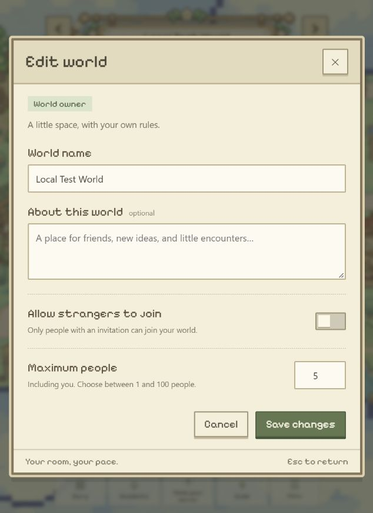
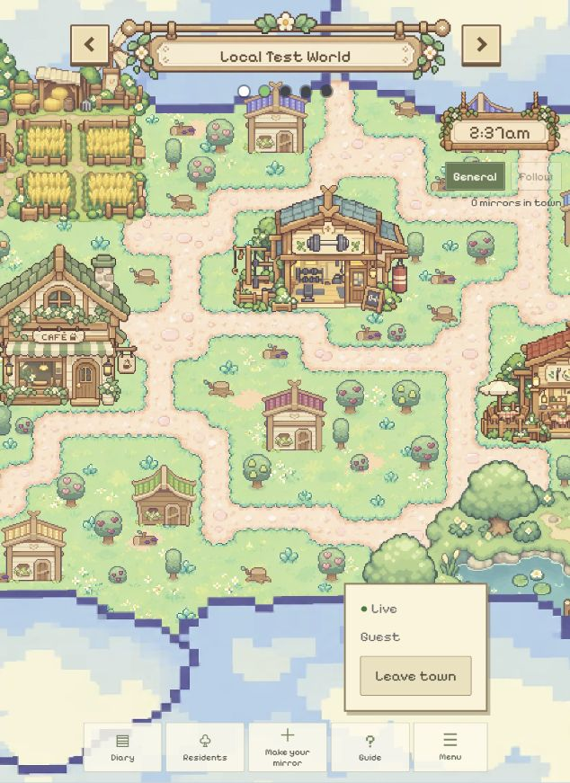

# 本机多世界后端交付 — 2026-10-25

基线：`yq` / `d85c3ed` 及已有未提交的世界 UI。用户先要求部署配套后端，再明确选择本机独立环境。

## 实际部署

- 官方 CLI/server 2.13.0 与项目 SDK 一致；独立数据目录、签名密钥和 CLI 身份在 `.local-backend/`。
- 后端监听 `127.0.0.1:3010`；库 `mirrorville-worlds-test`，新建及后续更新都使用 `--delete-data=never`。
- 前端监听 `127.0.0.1:5173`，worldtest 模式；HTTP 200。系统监听检查确认两个端口均为回环地址。
- 原 `spacetime.json` 的 Maincloud 目标、原 `.env.local` 和原共享库未修改／发布。只新增独立 `.env.worldtest.local`。
- 实际停止并重启本任务服务器，使用相同数据与密钥；重复启动脚本成功更新。两个浏览器身份刷新后仍选择 Local Test World，房主／成员权限及设置保留。
- `git check-ignore` 确认测试配置、私钥、CLI 配置被忽略。文档和截图不包含邀请 token 或签名密钥。

## 通过的验证

- 后端完整构建（安装模块锁定依赖后消除了初始缺少 tsc 的提示），CLI 发布与代码生成、前端 worldtest 生产构建、`git diff --check`。
- 39 项 Diary 测试（含新增同一主人不同世界日记隔离、模拟不会跨世界发起对话）；7 项 roaming、12 项 fidelity、10 项 importers、10 项 auth 测试通过，共 78 项。
- 实际 SDK 集成脚本使用 4 个新身份，加一个重连会话：创建、成员视图、非房主编辑拒绝、非成员切换拒绝、私人世界无邀请拒绝、错误邀请拒绝。
- 有效邀请加入及成员数同步；满员拒绝；房主不能把上限降到当前人数之下；开放世界入场；替换邀请后旧邀请拒绝。
- 并发抢最后一个名额：2 个同时加入请求只有 1 个成功，另一个收到 full。
- 分身按世界同步和移动；外部世界不见本轮角色。直接查询 7 个私有表（world/member/selection、mirror/conversation/line storage、diary_entry）均遭拒。
- 使用同一 token 重连仍保留成员身份、选中世界和非房主身份。邀请 token、身份 token 未写入测试输出。
- 实际前端：127.0.0.1 游客创建 Local Test World、复制邀请；localhost 独立游客在输入框加入同一世界，没有 Edit world 或伪角色选择器。房主在已有 2 人时设上限 1，界面展示后端拒绝信息；随后保存 5 成功。
- 重启后的房主设置与受邀访客菜单截图已保存。

## 已知未通过／未覆盖

- 既有 `test:status-card` 测试未通过：HEAD 已包含 ConversationTopics 界面，但其旧 VM loader 未加载该模块，部分断言仍引用已删除的 highlights 字段。本轮尝试核对后保留测试文件原样；不将该套件记为通过。相关产品源码仅改类型导入，以匹配生成绑定。
- 未进行真实 DeepSeek/Claude 调用、邮箱登录、邀请过期、跨机器访问或性能压测；测试环境不包含模型密钥。
- 本轮 UI 游客未创建个人分身，因此 Mirror Room 的真人浏览器往返仍未现场复验；所有世界保留同一个个人入口，SDK 分身创建／移动已经执行。
- 自动打开带邀请 hash 的链接后跳转空位已实现，但浏览器验收使用粘贴入口；此自动入口未单独验收。
- 未迁移或更新旧共享 schema；当前生成绑定与模块仅匹配新的测试库。

## 截图

