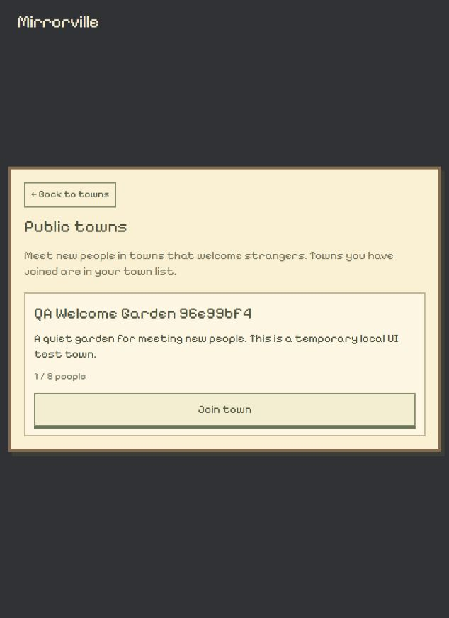

# 公共小镇发现列表

2026-10-25。用户明确 Explore the public town 应进入另一列表，包含当前用户尚未加入、允许陌生人加入的小镇。

## 实现与部署

- `App.tsx` 公共入口打开 `PublicTowns.tsx`，不再调用默认大厅的 enterWorld。主列表显示所有已加入小镇名称，包括默认大厅；Back to towns 返回主列表，不加入、不离站。
- `discoverable_worlds` 根据 ctx.sender 排除已加入世界，并过滤 allowStrangers 关闭和成员人数已满的世界。返回 id、name、description、maxMembers、memberCount 五个字段，无邀请、房主身份或分身资料。客户端也过滤人数已满项并按名称排序。
- 列表包含英文加载、重连、空列表和个人五位置已满提示。无位置时禁用加入；预览模式明确提示发现不可用。长名称／简介换行，长列表在居中窗口内滚动。
- 加入自动选择首个非公共空位，调用原 joinOpenWorld。后端事务再次验证权限和容量，使用已有原型创建独立分身；失败保留列表及错误，成功仍等待 my_worlds 当前选择确认才触发离站。
- `npm.cmd run setup:worlds` 实际使用 `--delete-data=never` 更新 3010 / mirrorville-worlds-test 并重新生成绑定。无破坏性 schema 变化，没有更新旧共享库、公开部署或配置 AI 密钥。首次沙箱内启动尝试受本地 socket 权限限制，随后获准在限制外运行同一脚本并成功。

## 实际验证

- `npm.cmd run build`：TypeScript + Vite worldtest 生产构建通过。
- `node --test scripts/test-world-journey.mjs`：5 项通过，包含无确认不离站、Skip/Replay、减弱动画及加载／卸载边界。
- `node scripts/test-public-towns-live.mjs --browser-fixture`：三个合成身份实际连接固定本机库，验证私人世界不公开、房主／已加入世界被排除、只有五个安全字段、设置与简介实时更新、关闭陌生人后加入被拒绝且无成员写入。
- 并发争抢最后一个名额：恰好一人成功；失败者无成员记录；满员世界从发现列表移除。扩大人数后仅未加入用户重新看到它。胜者自动产生与原世界不同 ID 的分身；重复加入不复制成员或分身，非房主读不到邀请。
- 浏览器 `http://127.0.0.1:5173/` 的 634×871 视口：公共入口实际进入第二层列表，出现合成 QA town 名称、简介、1 / 8 people 和 Join town。默认大厅与已有 Local Test World 仍在主列表；返回正常。截图保存在下方目录。
- `npm.cmd run test:public-towns:live` 对最终脚本复跑通过，实际确认它创建的小镇关闭陌生人后从订阅移除，再断开测试身份。保留合成记录，不改已有业务世界。
- 首次浏览器 fixture 运行保留一个临时 QA Welcome Garden，原脚本自动等待 15 分钟（约 03:57 PT 到期）后关闭陌生人入口；该进程的 stdin 无法输入换行，交付时仍在等自动关闭，未声称已清理。后续脚本已缩短为最多三分钟，并在 stdin 结束时提前清理。
- `git diff --check` 通过；根目录和子仓库离线阅读页重建。

## 未覆盖项

本轮不在已有浏览器身份中点击 Join town，避免永久占用其剩余世界位置；真实加入、容量竞争和自动分身由合成身份通过 SDK 验证。浏览器成功加入后的完整离站组合路径本轮未重新覆盖；它复用既有确认流程与本轮通过的 renderer 回归测试。空列表、个人位置已满、断线提示、超长列表和其他视口仅有代码处理，未做本轮实际布局检查。发现按成员容量筛选；实际加入仍可能因分身容量等事务检查被拒绝。未验证真实 AI 内容、公开环境或性能压测。
