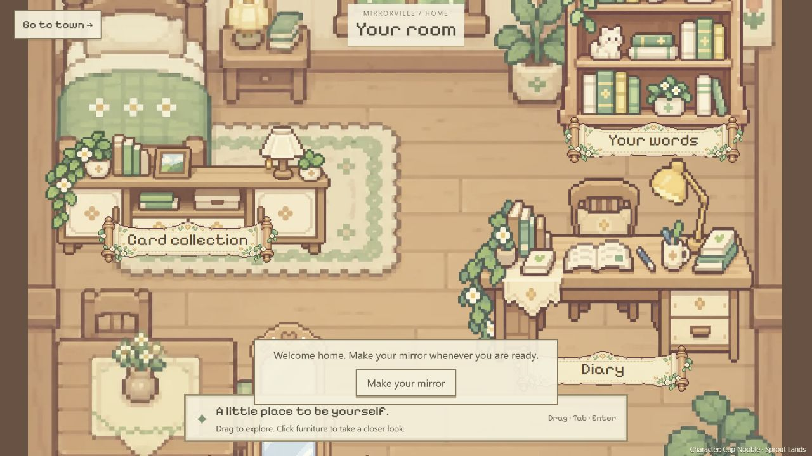

# 初次进入直接出现在 Mirror Room

2026-10-25。用户明确初次进入时玩家直接出现在 Mirror Room，而不是地图或小镇选择页。

## 实现

- `App.tsx` 默认 `roomOpen=true`、`journeyOpen=false`。已有分身时使用当前世界自己分身中稳定最小 ID 的房间；此选择不声称 ID 表示创建时间。
- `MirrorRoom.tsx` 不再因没有分身返回空白，而是显示原 PixelRoom 房间、Your room 和 Make your mirror。身份／世界／分身订阅就绪前禁用创建与出发。点击家具也会提供创建入口，不伪造个人档案或日记。
- 房间内创建复用原 CreateMirror 问卷和 reducer；取消留在房间，成功关闭问卷并依订阅显示新分身的房间。不自动离站。无分身用户也可以直接出发，继续使用原首次创建流程。
- 出发按钮统一为 Go to town，调用原动画入口。邀请参数不抢占初始房间，等实际出发打开旅程后才选择邀请空位。Town Map 左右按钮和地图菜单行为保持上一轮实现。
- 无后端发布、身份修改、分身创建或数据库迁移。

## 实际验证

- `npm.cmd run build`：TypeScript + Vite worldtest 生产构建通过。
- `node --test scripts/test-home-scene.mjs scripts/test-world-journey.mjs`：8 项通过，覆盖房间素材与布局来源、加载／重试及车动画的确认／跳过／减弱动画／卸载边界。
- 浏览器 `http://127.0.0.1:5173/`，1280×720：游客进入后直接显示 Your Mirror Room、房间家具、Go to town 和创建提示，没有先显示小镇选择或开车动画。
- 点击 Make your mirror 实际在房间上打开原问卷；Cancel 回到同一房间，未提交资料或产生分身。
- 点击 Go to town 实际开始离家上车画面；Skip 后显示小镇列表；选择已有 Mirrorville Test 后显示 Next stop / Travelling，随后自动进入地图。没有新建／加入其他小镇。
- 从地图刷新页面，实际回到 Mirror Room，而不是地图／选择页，房间家具可见。
- `git diff --check` 通过；根目录和子仓库离线阅读页重建。

## 未覆盖

本轮浏览器身份没有自己的分身，因此实际覆盖无分身房间与出发；已拥有分身时的初始个人房间选择，以及提交创建成功后的订阅衔接仅由代码／构建确认，没有写入真实用户的问卷来验证。邀请链接从房间出发后的衔接、网络中断、其他视口和真实邮箱登录未在本轮重测。此改动只决定页面入口，不证明 AI 模拟或公开部署已完成。
