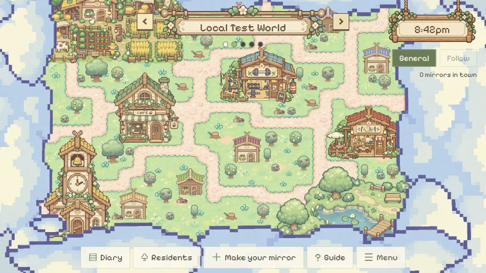

# 开车动画仅从 Mirror Room 触发

2026-10-25。用户明确：开车动画只在从 Mirror Room 出发时出现；Town Map 的 town controller 左右按钮不触发动画。

## 实现

- `App.tsx` 的 `journeyAnimated` 初始为 false。唯一传入 true 的入口是 `MirrorRoom.onBack`，即 Back to town；它保留离家／上车、选择目的地、后端确认后离站的流程。
- 初次进入和地图菜单 Travel to a world 直接显示无动画选择页。`WorldJourney.tsx` 的静态模式不创建 DepartureScene、不渲染 canvas 和动画工具栏；收到后端确认的目的地后立即显示小镇。
- `WorldNavigator` 左右按钮独立调用 `changeMapWorld`。已有位置等待 enterWorld 成功后切换视图，失败保留原位置并显示 notice；空位直接显示原 EmptyWorld 创建／加入表单。忙碌时禁用连续切换。
- 无后端修改、数据库发布、分身迁移或创建测试分身。

## 实际检查

- `npm.cmd run build`：TypeScript + Vite worldtest 构建通过。
- `node --test scripts/test-world-journey.mjs`：5 项既有 renderer 回归通过，包括确认后离站、Skip/Replay、减弱动画和加载／卸载边界。
- 浏览器 `http://127.0.0.1:5173/`，1280×720：游客进入直接显示 Town selection，没有车 canvas／Skip／Replay；选择 Mirrorville Test 直接显示地图。
- 点击 Next world：Mirrorville Test → Local Test World 直接切换地图。继续 Next world → World 3 显示原创建／加入窗口。Previous world → Local Test World 立即返回地图，没有车动画；验证了返回仍是服务器当前世界时的空位往返。
- 地图 Menu → Travel to a world 实际打开静态 Town selection，无动画控制项。
- 源码检查确认 `beginJourney(true)` 只有 Mirror Room 返回入口；`WorldNavigator.onChange` 不再调用 beginJourney。
- `git diff --check` 通过。根目录和子仓库离线文档阅读页重建。

## 未覆盖

本轮浏览器身份在这两个小镇都没有已有分身，因此没有创建分身来做 Mirror Room 点击的端到端检查；该入口接线由源码核对，动画行为由既有 renderer 测试覆盖。没有注入浏览器身份、填写人格资料或占用额外小镇位置。真实网络错误提示、其他视口及从 Mirror Room 创建／加入新世界的组合路径未在本轮重测。
