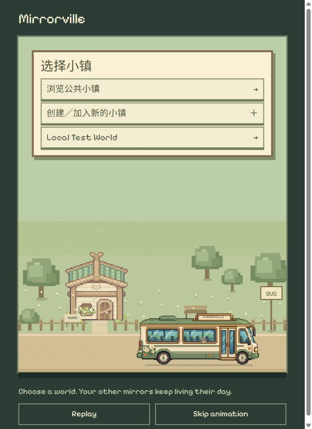

# 小镇选择选项调整

2026-10-25。用户明确要求上车后的选择面板只列出：浏览公共小镇、创建／加入新的小镇，以及已在小镇列表中的实际名称。

`App.tsx` 目的地面板现保留两个固定入口，随后仅罗列已存在的非公共小镇名称。不再列出未创建的 World 3/4/5 等位置；公共大厅已经有固定入口，不重复显示名称。公共入口调用现有第 0 位置的进入逻辑，仍等待后端确认后才离站。

创建／加入入口自动选第一个非公共空位，展示现有 EmptyWorld 的邀请／创建操作；标题不再暴露占位世界编号。5 个位置都占用时显示容量提示，不覆盖已存在小镇。原地图五点导航、后端位置容量、成员权限及独立分身逻辑未更改。

## 实际检查

- `npm.cmd run build`：TypeScript 与 Vite worldtest 构建成功。
- 浏览器 localhost 的实际面板只显示 3 个目的地按钮：浏览公共小镇、创建／加入新的小镇、Local Test World；没有未创建位置，也没有重复公共大厅名称。
- 点击创建／加入出现深灰色入口、邀请输入和创建按钮；返回列表正常，没有创建或加入新世界。
- 点击公共入口，实际看到 Next stop: Mirrorville Test，随后到达 Mirrorville Test 地图，确认绑定现有公共大厅。
- `git diff --check` 通过，文档阅读页重建。此低影响展示改动没有新增测试或重跑上一轮 93 项套件。满位置提示未在真实用户记录上造满验证。

## 后续语言修正

用户明确这是英文 App。App.tsx 的相关标签现为 Choose a town、Explore the public town、Create or join a town、Back to towns，满位置提示也为英文。用户自定义名称不翻译。生产构建通过，App／WorldJourney／旅程 CSS 扫描无中文；上方截图保留语言修正前的历史检查。仅文案改动，未新增测试。
