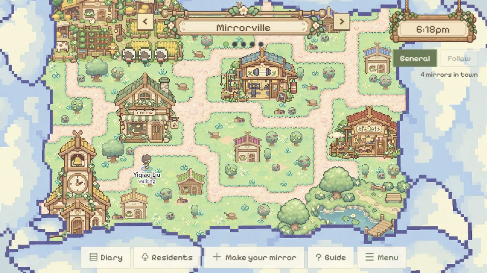
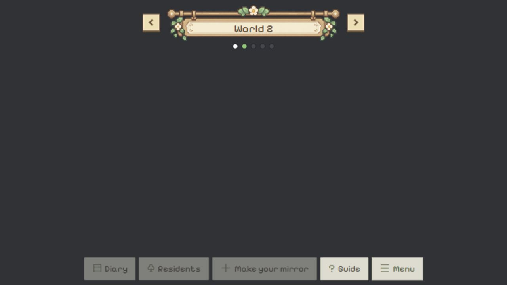
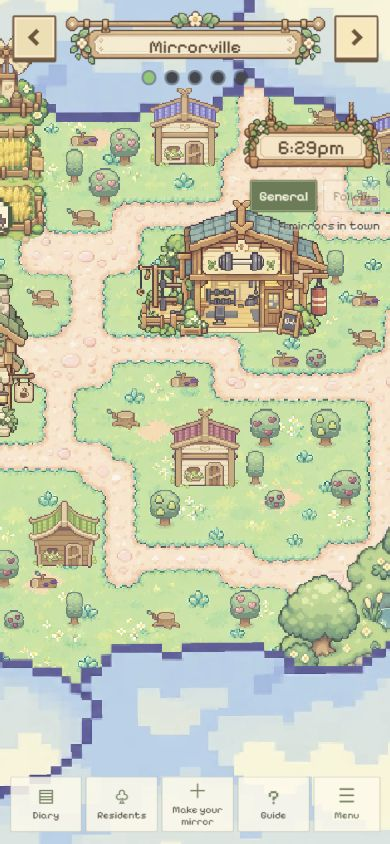
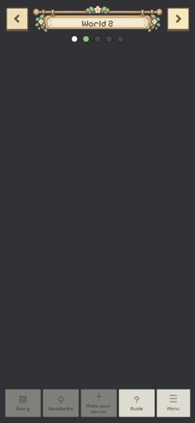

# Town Map world navigation — 2026-10-25

Base: `yq` at `d85c3ed`; checks cover the local working-tree addition.

## User request and delivered scope

- Use the attached floral timber nameplate at the top of Town Map for the current world name.
- Five dots: green current slot, white existing slot, dark gray uncreated slot. Current
  selection takes green precedence even when selecting an uncreated slot.
- Previous/next buttons change worlds. An uncreated world has a solid dark-gray background.
- The existing shared Mirrorville occupies slot 1; slots 2–5 are uncreated. The selector
  wraps at both ends. Empty slots have no canvas/characters/clock/camera and disable Diary,
  Residents and mirror creation. Guide and Menu remain available. The user's follow-up
  keeps Mirror Room enabled whenever an owned mirror is available, independent of slot
  or connection state; it opens the same personal room and returns to the selected slot.
- User image is copied byte-for-byte as `public/assets/ui/world-nameplate.png`, retaining
  RGBA transparency. SHA-256: `3c2b8cf9f28bbc0698295634e0f3c23bdf9a387fc5f385df5675326a267e9794`.

## Actual checks

- PASS: `npm.cmd run build` (TypeScript and Vite production bundle); `git diff --check`.
- Actual local browser at `http://127.0.0.1:5173/`, guest entry, loaded authored town and
  received 4 mirrors during this check. No mirror was created or edited.
- PASS: 1280 × 720 desktop and 390 × 844 portrait screenshots inspected. World name
  remains inside the supplied frame, arrows are visible/clickable, five dots appear
  below it, and the mobile clock/camera sit below the navigator.
- PASS: Next sequence from Mirrorville is World 2, World 3, World 4, World 5, Mirrorville.
  Enter on Previous at Mirrorville goes to World 5. Returning from an empty slot restores
  the authored map and residents.
- PASS: empty World 2 has zero `canvas.world` elements. Its computed background is
  `rgb(48, 50, 54)`; dots are white `rgb(255, 255, 255)` for Mirrorville, green
  `rgb(121, 202, 106)` for selected World 2, dark gray `rgb(68, 71, 76)` for the rest.
- PASS: Diary, Residents and Make your mirror are disabled in the empty slot and reenabled
  on return to the live town (subject to the existing connection state).
- PASS: portrait document width is 390px, matching the viewport without horizontal overflow.
- Temporary browser viewport override restored after checking.

## Limits

Follow-up source check: Mirror Room has no disabled condition and continues to open
`myMirrors[0].id`; the room's Back handler only clears `roomFor`, retaining `worldIndex`.
Production build passed after this change. The guest browser used above had no owned
mirror, so the owned-room round trip was not exercised live in that session.

This is a frontend slot preview. No world creation, membership, invite links, server
authorization, independent simulation, cross-world identity or random discovery is implemented
by this change. Empty-slot navigation does not disconnect or pause the existing town. Selected
slot is in component state and resets on reload. Backend source/schema, shared data and
authentication configuration are unchanged. Physical phones and other browsers were not tested.

## Screenshots

