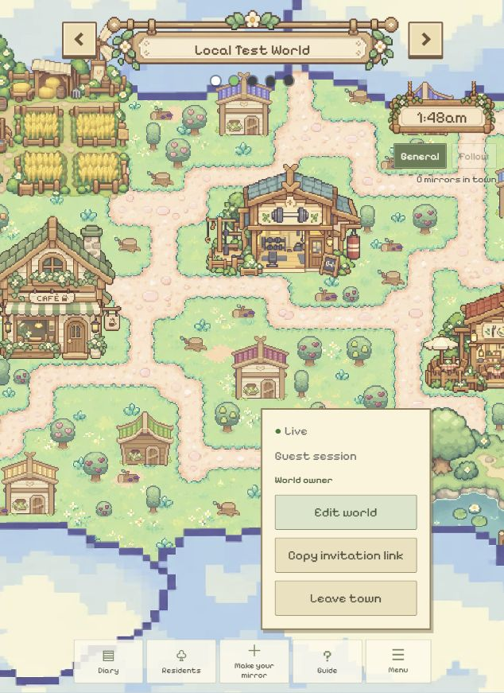
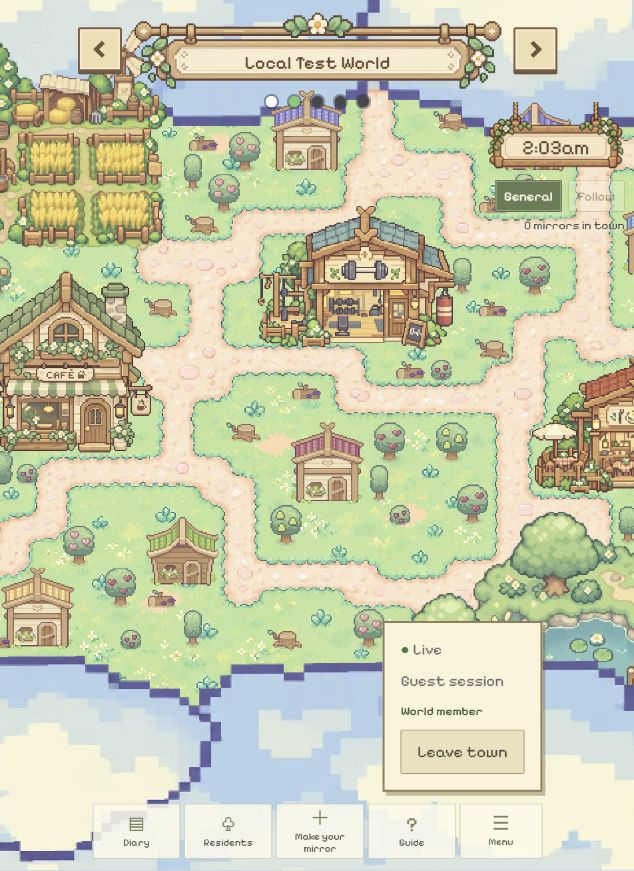

# 房主与游客登录标签区分

2026-10-25。用户询问创建房间的人为何显示 Guest。

## 原因与改动

`SessionRoot.tsx` 以登录方式传入 `sessionLabel=Guest`；`App.tsx` 以前直接显示该字段，没有展示服务器 `my_worlds.isOwner` 对应的世界角色。Guest 指游客登录，不代表世界访问权限。游客身份也可以创建世界并成为房主。

菜单现分别显示 `Guest session`（登录方式）与 `World owner` / `World member`（当前世界角色）。角色取自服务器世界记录，房主编辑／邀请按钮继续按原有服务器权限显示；空世界不显示虚构角色。保留账号名称的完整悬停提示。此修复只修改前端标签与样式，无后端授权变更。

## 实际检查

- `npm.cmd run build` 成功（TypeScript + Vite worldtest）。
- 实际浏览器同一 Local Test World：`http://127.0.0.1:5173/` 菜单显示 Guest session、World owner、Edit world、Copy invitation link；`http://localhost:5173/` 显示 Guest session、World member、Leave town，无房主入口。
- 两个 origin 的游客身份独立，来自各自 localStorage 的游客 token。用户从创建时的 127.0.0.1 切到 localhost，并不会自动沿用房主身份。没有将成员提升为房主，也没有读取或记录 token。
- `git diff --check` 通过。根目录与子仓库文档阅读页重建。此小型展示修复未新增单元测试、未重新执行数据库集成套件。

