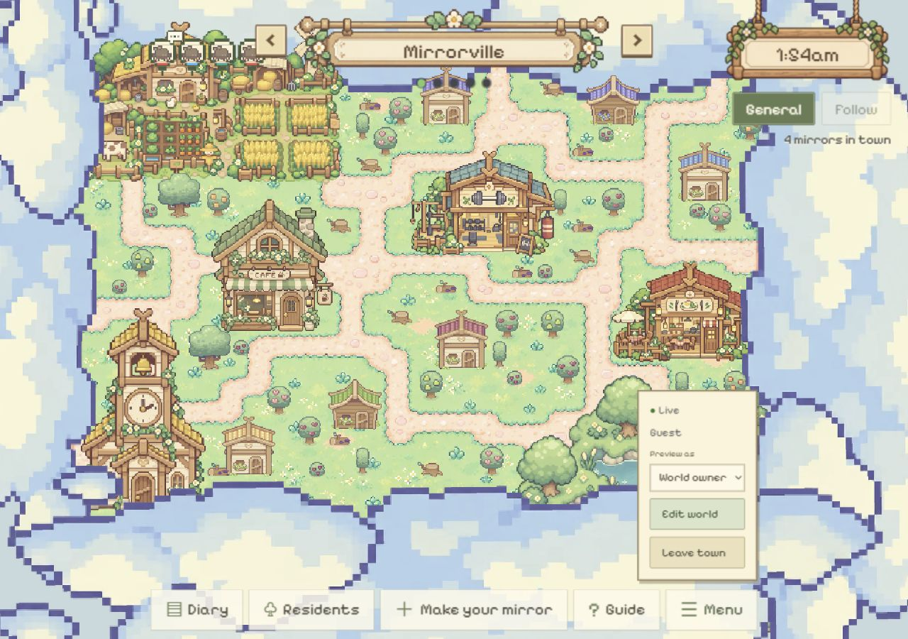
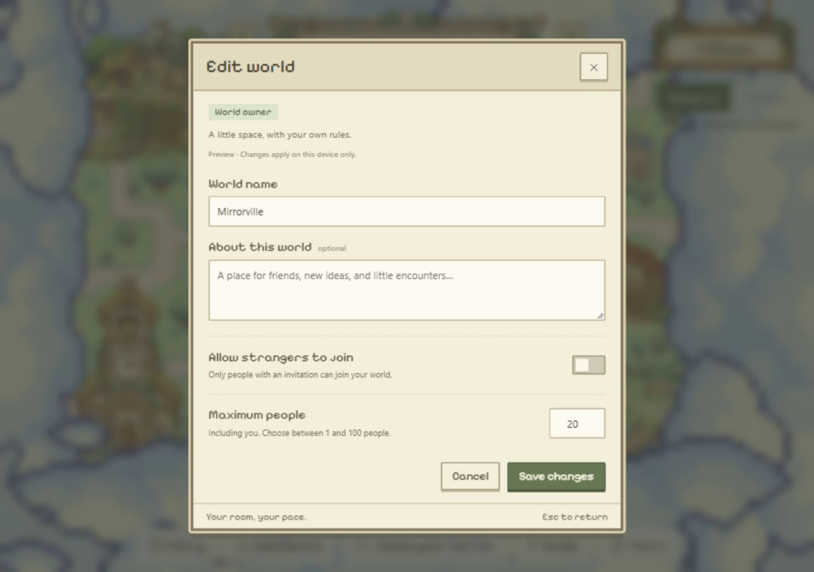
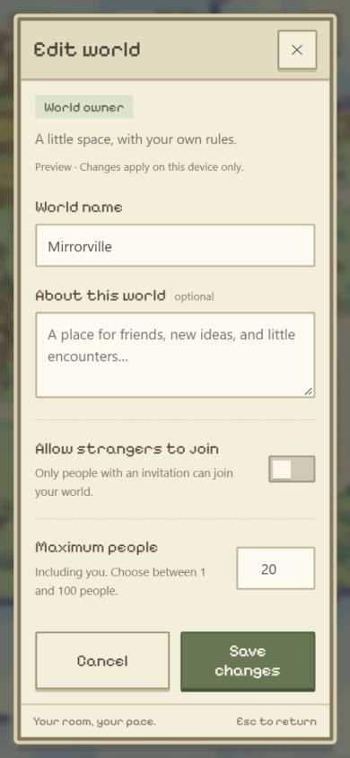
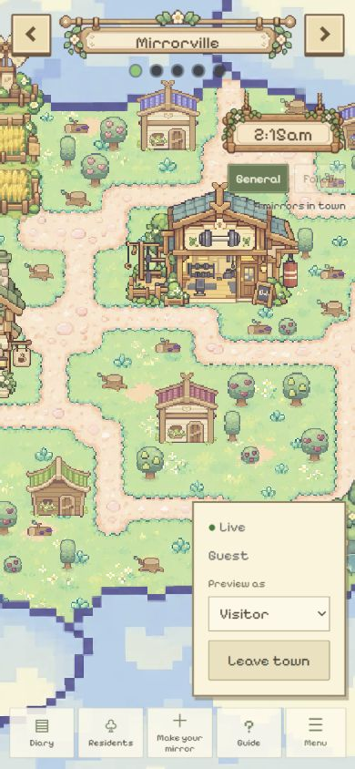

# Edit world frontend preview — 2026-10-25

Base: `yq` at `d85c3ed`, with the uncommitted world navigator and this local addition.

## Scope and source

User asks for Edit world in Menu for a town's creator, including stranger admission and
maximum people. Asked whether to implement a frontend owner/visitor preview or real
ownership/backend saving, the user selected frontend preview.

- Preview as: World owner (initial view) or Visitor; independent of real login identity.
- Existing town + owner preview: Edit world visible. Visitor or empty slot: hidden.
- Fields: world name, optional introduction, allow strangers, maximum people including
  owner. Current preview defaults: strangers off / 20 people; allowed UI range 1–100.
  These capacity values are implementation choices, not a confirmed production policy.
- Browser storage persists values per world ID and origin; Save updates the top title.
  Cancel, Escape and close discard drafts. The UI identifies these as device-only previews.

## Actual validation

- PASS: `npm.cmd run build` (TypeScript and Vite) and `git diff --check`.
- Actual local browser used the existing authored map/guest session, without creating a
  mirror, sending invitations or writing shared database data.
- PASS: owner Menu shows Edit world; switching Preview as to Visitor removes it from
  the DOM; returning to owner restores it. Selecting uncreated World 2 hides it even
  in owner view.
- PASS: saved Garden Club / a sample introduction / strangers on / 12 people. Top title
  changed immediately; after full reload all four values remained when reopening settings.
- PASS: changed the draft title to Unsaved change, canceled; top title remained Garden Club.
  Another draft Temporary draft was dismissed using Escape; title remained Mirrorville.
- PASS: values 0 and 101 blocked Save with browser range validation. Only whole numbers
  between 1 and 100 are accepted by input constraints and the submit handler.
- PASS: default values restored through the form after checking: Mirrorville, blank
  introduction, strangers off, 20 people. No shared world metadata was changed.
- PASS: screenshots inspected at 1280 × 900 and 390 × 844. Portrait document width 390px,
  dialog width 352px / scroll width 344px; no horizontal overflow. Fields, switch and both
  action buttons remain visible. Viewport override restored.
- Final preview left at the owner Edit world panel.

## Limits

Preview role is not verified creator identity, and resets to owner on reload. Browser
settings are shared by sessions at this origin, not synchronized across devices and not
authoritative. Strangers/capacity choices do not affect the server's existing global
simulation, mirror creation cap, membership or admission. Invite links, actual member
counting, backend ownership validation and database persistence remain pending.
Physical devices, storage-denied saving and other browsers were not exercised.

## Screenshots

