# Teammate Home scene integration

2026-10-24 · `yw/map-assets` · source `origin/yq` commit `1f404a9`.

## Change

Replaced the provisional SVG room with the five unchanged PNGs and authored Sprite2D
positions/scales/order from `mirrorvile/Home.tscn`. The bookshelf opens the existing import/notes
panel, the card desk opens cards, the mirror opens self/summary, and the diary opens the existing
private journal. A bedside cabinet hotspot retains the address book; the character remains clickable.
All furniture uses native buttons with accessible labels and focus indication.

## Validation

| Check | Result |
| --- | --- |
| Production build | Pass |
| Five PNG hashes/dimensions and all authored transforms/order match source | Pass (automated) |
| Desktop: original composition and all five furniture controls visible | Pass (browser) |
| Bookshelf → import panel with file selection, Read as, text/notes controls | Pass; opened only, no import submitted |
| Card desk → card collection | Pass |
| Mirror → self/summary panel | Pass |
| Diary → paginated private journal | Pass |
| Address book → private contact form | Pass; no contact changed |
| Closing each panel returns focus to its furniture button | Pass (browser accessibility state) |
| 390×844 portrait room, reachable controls and no visible horizontal overflow | Pass (browser; diary opened) |
| Complete regression suite including scene tests | Pass (55 tests) |
| Teammate device opens the shared preview | Pending |

No database publication, data reset or mixian (id 9) edits were performed. No raw source messages
or contact values are included in this record. Visual screenshots are kept outside the repository.

## Loading repair (2026-10-24)

Owner screenshot showed incomplete layers during a slow room load. Five original PNGs total
5,344,427 bytes; runtime WebP copies total 347,174 bytes (93.5% reduction), preserving
dimensions/alpha. Original art/hash tests remain unchanged. Owned sessions warm up the room
with low-priority image requests after five seconds in town. Room mounting shares a cached
all-images-decoded promise and hides partial layers until ready; errors expose Retry.
Build/typecheck: Pass. Home suite: Pass (3 tests), including shipped WebP existence, shared
load/decode/cache and retry after failure. Actual phone/network seconds and visual loading
state: Pending (owner testing). No database changes or private data involved.

## Remove standing room character (2026-10-24)

At the user's request, local `yq` working changes remove the standing character button and name
from `src/PixelRoom.tsx`, remove its unused name/look props at the `MirrorRoom` call site, and
delete its desktop/mobile CSS. The mirror furniture remains the entry to the existing self panel.
This removes the scene decoration; no mirror records or town characters are deleted.

`npm.cmd run build`: TypeScript and Vite passed. Browser check used the actual `PixelRoom`
component in a temporary local preview without database access: all five furniture buttons
were visible and each dispatched the correct `onOpen` value (`mirror`, `diary`, `cards`, `desk`,
`contacts`). The rendered scene had no standing character or character name. The preview file
was removed afterward. Full owned-session data/panel loading and physical phones were not
exercised for this change.

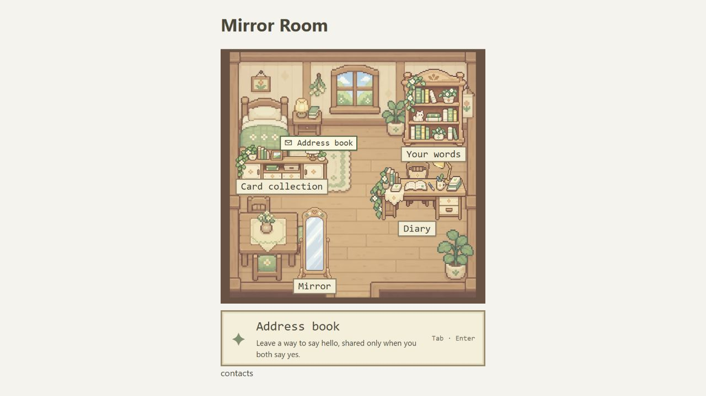

## Full-screen room (2026-10-24)

Following the user's request, local `yq` working changes make the room fill the viewport like
the town. `App.tsx` uses a dedicated room shell; `MirrorRoom.tsx` floats the heading, return
button and collapsible owner summary over the scene. `PixelRoom.tsx` and `pixel-room.css`
scale the authored composition uniformly to cover the viewport. Native bounded scrolling,
mouse/pen dragging and arrow keys expose cropped areas without stretching artwork. Dragging
across furniture suppresses its click. Five fixed furniture shortcuts keep every panel
reachable when the matching object is cropped. The standing character remains removed.

Validation used the actual `PixelRoom` and `RoomDialog` components in a temporary local
preview with matching shell/header markup and fixture callbacks, without owner data or
database access. The fixture was removed after checking.

- Production TypeScript/Vite build passed; the existing Home scene/delivery suite passed 3/3.
- Desktop 1280 × 720: room viewport starts at (0, 0), with a 1280 × 1233.73 scene covering
  it. Dragging across a furniture area changed vertical scroll from 257.33 to 437.33 without
  opening a panel; ArrowUp moved it by 80 pixels.
- Portrait 390 × 844: uniformly scaled scene is about 875.65 × 844; viewport coverage checked
  after resizing. Horizontal drag changed scroll from 243.33 to 83.33. Header and wrapping
  furniture dock stayed visible.
- In both sizes, each of the five shortcuts dispatched its correct object ID to the actual
  dialog component; close returned to the room. The summary disclosure and return callback
  worked in the preview. Browser viewport was restored afterward.
- Full owner-session panel contents, physical touch devices and other browsers were not
  exercised. No database writes/publication or changes to town camera behavior were made.

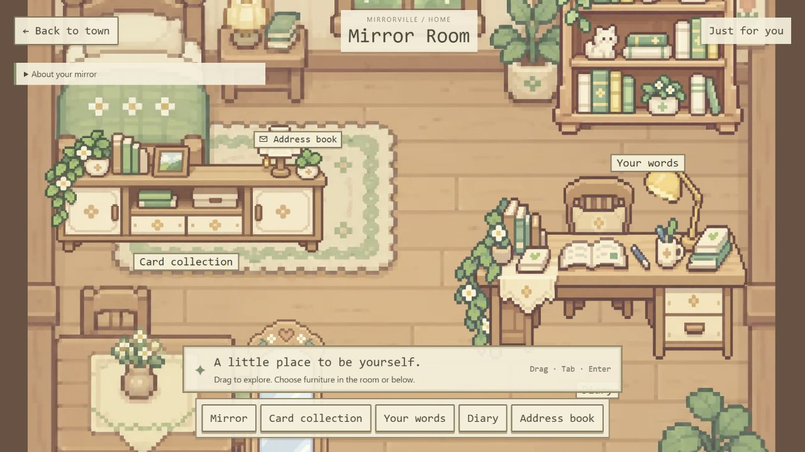

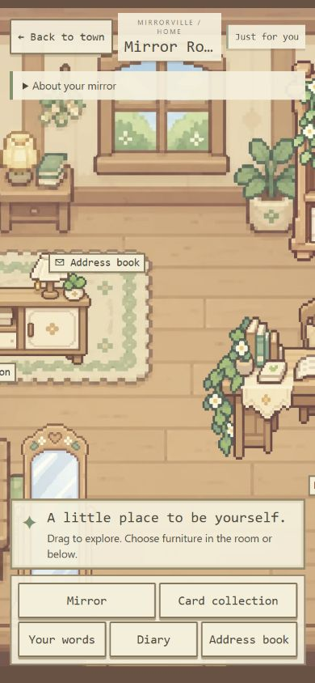

## Simplified room controls (2026-10-24)

The user requested removal of “About your mirror”, “Just for you” and all bottom shortcut
buttons. Removed their JSX and unused CSS, plus the now-unused owner-summary table hook in
`MirrorRoom.tsx`. The remaining bottom hint describes direct furniture interaction and sits
near the bottom edge. Room artwork, panning, furniture hotspots and panel handlers remain.
This supersedes the shortcut/summary parts of the earlier full-screen layout above.

- `npm.cmd run build`: TypeScript/Vite passed.
- Used actual `PixelRoom` and `RoomDialog` components in a temporary local preview with matching
  header markup and fixture callbacks, without database access. At 1280 × 720 and 390 × 844,
  clicked each of the five in-scene buttons (mirror, cards, writing desk, diary and address
  book); each opened its corresponding dialog, then closed normally. No shortcut dock or
  summary/privacy controls remained in the rendered view.
- Saved and visually inspected the portrait preview; desktop screenshot also retained.
  Temporary preview file removed; browser viewport restored. Full owned-session data and
  physical touch devices were not exercised. No database writes were made.

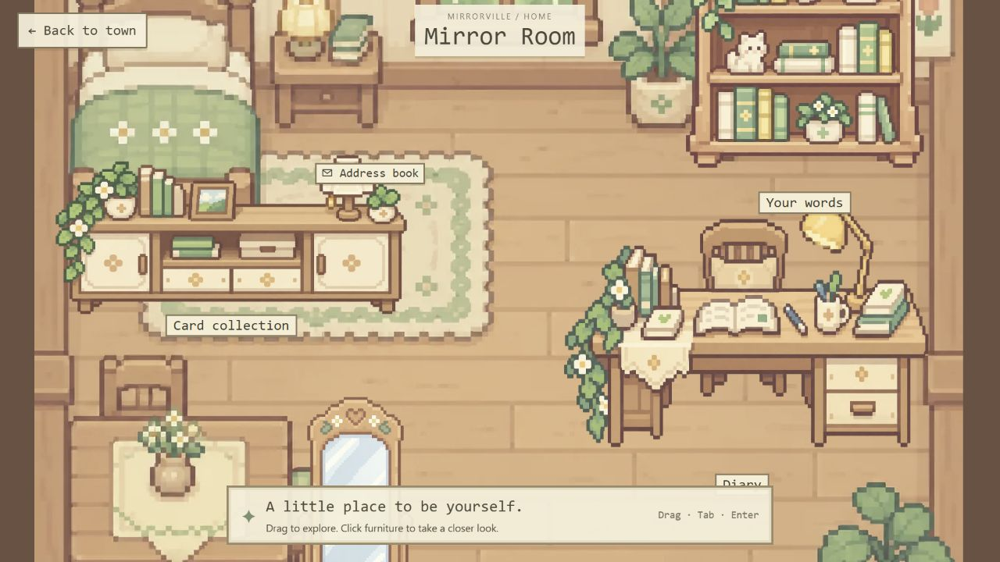

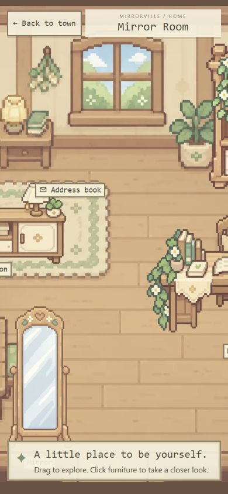

## Contact editing merged into the mirror (2026-10-24)

At the user's request, the existing `ContactField` is now inside the mirror panel below its
self-card/card-collection content. Removed the independent Address book hotspot, its `contacts`
room-object route and unused CSS. The room has four furniture entries: mirror, cards, writing
desk and diary. The mirror hint mentions contact editing. The form's save reducer, 120-character
limit, clear behavior and mutual-interest sharing explanation are unchanged.

- `npm.cmd run build`: TypeScript and Vite passed.
- `node.exe --test scripts/test-diary.mjs scripts/test-home-scene.mjs`: 16/16 passed, including
  contact ownership/length/clearing, mutual-interest privacy, later contact propagation, and
  authored room layout/asset checks.
- Browser preview rendered a source copy of the actual `MirrorRoom.tsx`, with only the
  SpacetimeDB React hook import replaced by a temporary fixture module. Real `PixelRoom`,
  `RoomDialog` and the unchanged `ContactField` rendered with synthetic profile data. No live
  database provider was used. The copied module, hook fixture and preview HTML were removed.
- At 1280 × 720, clicking the mirror opened both profile and contact settings in one panel;
  there was no Address book button. With the fixture reducer, saved `preview@example.test`,
  closed/reopened and confirmed the value remained, then cleared it and saved again. The
  field retained `maxLength=120`; Save was disabled when unchanged.
- At 390 × 844, the contact section remained reachable inside the scrollable mirror dialog;
  client width and scroll width both measured 329px (no horizontal overflow). Screenshots
  were visually inspected. Browser viewport restored after checking.
- Real database saves and complete account-session flows were not exercised; the browser
  save checks used an in-memory fixture. No database writes/publication were performed.

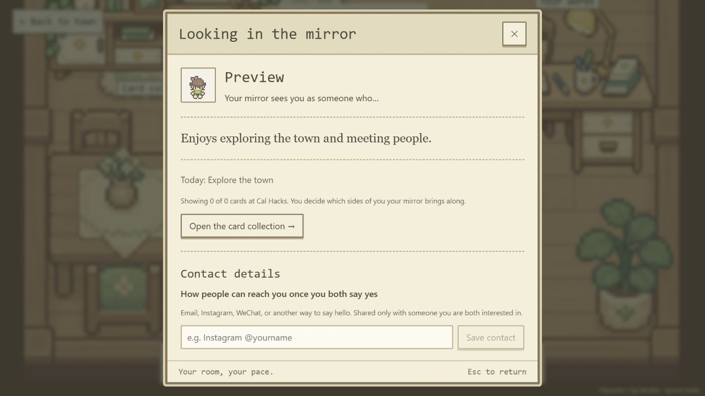

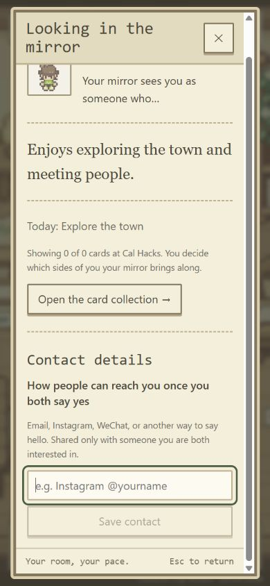

## Scroll nameplates (2026-10-24)

At the user's request, the Mirror, Card collection, Your words and Diary name frames now use
the attached floral scroll. [room-nameplate.png](../../public/assets/ui/room-nameplate.png)
is an unchanged copy of the supplied 2172 × 724 RGBA image (1,201,137 bytes). CSS retains
the 3:1 aspect ratio and transparency, overlays live centered text, widens long labels and
uses smaller minimum dimensions on portrait screens. Hover/focus brightens the scroll rather
than restoring a plain rectangular frame. The mirror label is raised above the bottom hint.

- Production TypeScript/Vite build passed.
- Browser check used actual `PixelRoom` and `RoomDialog` components in a temporary local
  fixture with matching room shell/header and local callbacks, without database access.
- At 1280 × 720 and 390 × 844, clicked each of the four nameplate spans; all opened the
  corresponding panel and closed normally. Card collection measured 237 × 79 CSS pixels
  on desktop and 212 × 71 on portrait; scroll width equaled client width in both cases.
- Visually inspected portrait nameplates and retained screenshots at both sizes. The room
  remains draggable to reveal furniture outside the current crop. No room shortcuts or
  Address book entry were reintroduced.
- Removed the temporary preview and restored the browser viewport. Physical phones and
  other browsers were not checked; no database writes or publication occurred.

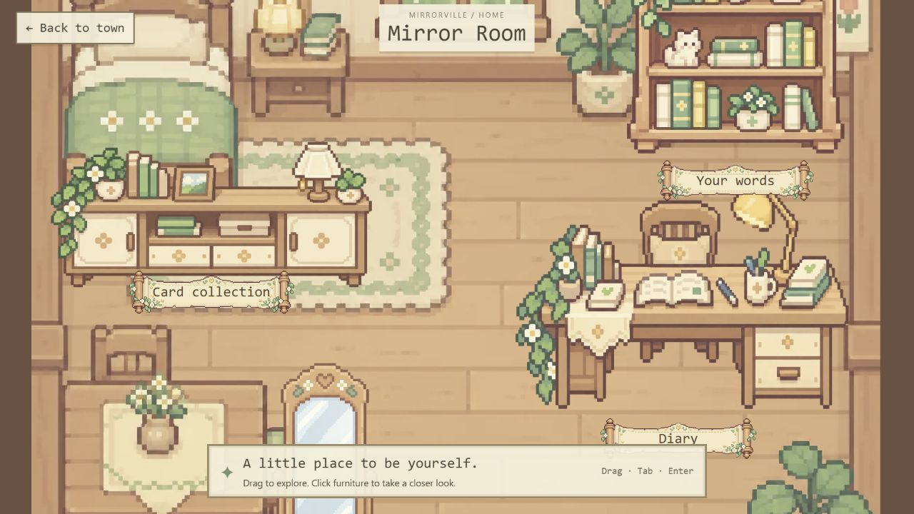

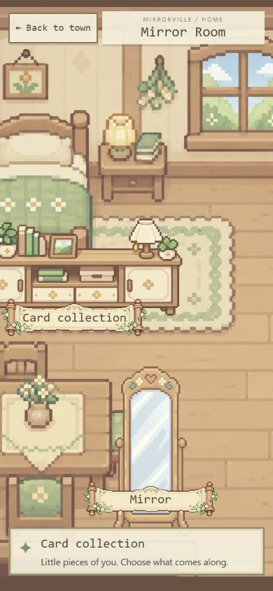

## Larger, raised nameplates (2026-10-24)

The user requested that names and labels be enlarged together and moved upward. The shared
`.home-object > span` transform now scales text and scroll art by 1.3 and moves the label
center upward by 32 CSS pixels. Individual furniture positions and the mirror's existing
additional height offset are retained.

Production TypeScript/Vite build passed. In the actual room/dialog component preview with
local fixture callbacks, clicked and closed all four label panels at 1280 × 720 and 390 × 844.
Portrait Card collection measured about 276px visually from a 212px layout width, consistent
with the 1.3 scale. Both screenshots were visually inspected; text and frames remain aligned.
Temporary preview removed, browser viewport restored. No database access or writes; physical
touch devices and other browsers were not checked.

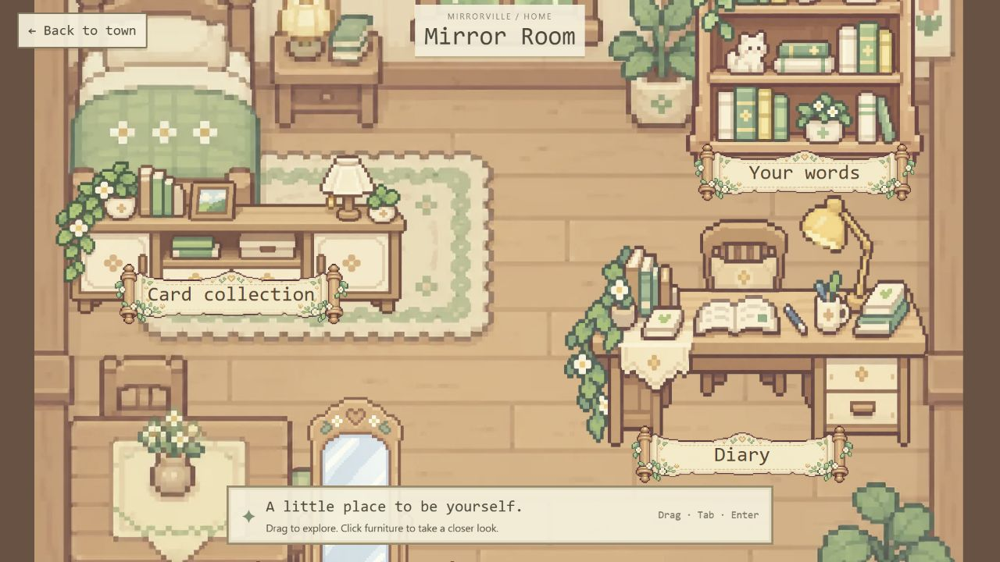

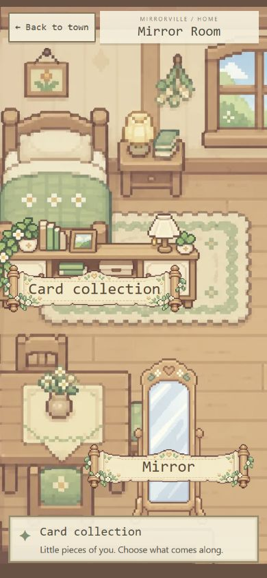
